찰리와 걷기 백엔드를 개발하면서 인증부터 활동 데이터 저장, 통계 집계, 캐시, 배포 자동화까지 여러 기능을 구현했습니다.

이번 글에서는 NestJS와 Prisma로 서버를 구성하고 운영 과정에서 데이터 조회와 배포 방식을 개선한 과정을 순서대로 정리해보겠습니다.

> **예제 코드 안내**
>
> 코드와 다이어그램의 이름·순서·값은 개념 설명을 위한 예시이며 실제 서비스 정책을 나타내지 않습니다.
{: .prompt-info }

---

## 1. 프로젝트 구성

먼저 프로젝트에서 사용한 기술을 간단하게 정리해보겠습니다.

| 영역 | 사용 기술 | 해결하려던 문제 |
|---|---|---|
| 애플리케이션 | Node.js, TypeScript, NestJS | 기능별 모듈화와 의존성 관리 |
| 데이터 | Prisma, MySQL | 타입 안전한 영속성과 일관성 |
| 캐시 | Redis | 반복 조회 비용과 응답 지연 완화 |
| 인증 | JWT, 소셜 로그인 | 모바일 클라이언트 인증 |
| 실행 환경 | Docker, 프로세스 매니저 | 환경 일관성과 다중 프로세스 운영 |
| 배포 | GitHub Actions | 반복 가능한 빌드·배포 |
| 관측성 | 오류 추적, APM | 장애 원인과 병목 구간 파악 |

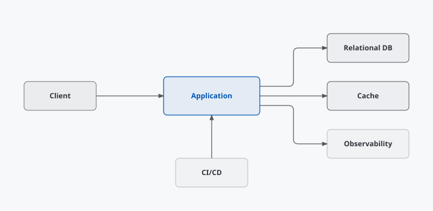{: .light }
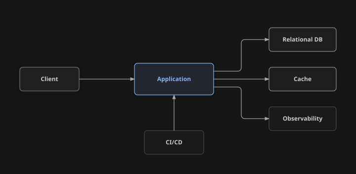{: .dark }
NestJS 애플리케이션에서 요청을 처리하고 MySQL에는 원본 데이터를 저장했습니다. Redis는 반복되는 계산 결과를 보관하고 오류 추적 도구와 APM은 운영 중 발생한 문제를 확인하는 데 사용했습니다.

---

## 2. JWT 인증 구성하기

먼저 모바일 클라이언트의 인증 방식을 정해야 했습니다. 서버 세션을 공유하는 방법과 서명된 토큰을 사용하는 방법을 비교한 후 JWT 기반 인증을 구성했습니다. 토큰 방식은 다중 프로세스에서도 별도의 세션 저장소 없이 요청을 검증할 수 있다는 장점이 있었습니다.

다만 JWT를 사용한다고 인증 설계가 끝나는 것은 아닙니다.

- Access Token 수명
- 갱신 토큰의 저장과 회전
- 로그아웃과 강제 만료
- 탈퇴·차단 계정의 처리
- 비밀번호 해싱 비용
- 소셜 로그인 공급자 검증

이 값들은 코드에 직접 넣기보다 환경별 설정으로 분리해야 합니다.

~~~typescript
interface AuthPolicy {
  accessTokenTtl: string;
  refreshTokenTtl: string;
  passwordHashCost: number;
}

function issueAccessToken(subjectId: string, policy: AuthPolicy) {
  return sign({ sub: subjectId }, {
    expiresIn: policy.accessTokenTtl,
  });
}
~~~

예시 코드에는 구체적인 수명을 넣지 않았습니다. 값의 정답은 서비스의 위험도, 재인증 UX, 클라이언트 갱신 구현, 사고 대응 절차를 함께 고려해 결정해야 하기 때문입니다.

### 소셜 로그인 연결하기

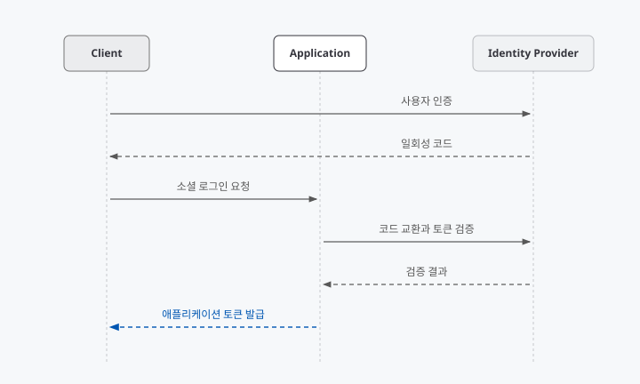{: .light }
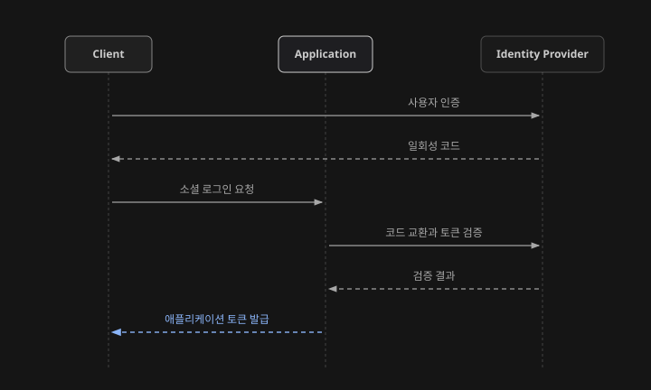{: .dark }
공급자용 비밀키는 서버에만 두고 클라이언트가 전달한 결과를 그대로 신뢰하지 않으며 토큰의 서명·발급자·대상자를 서버에서 검증해야 합니다.

---

## 3. 활동 데이터 중복 처리하기

그다음으로 모바일에서 전달되는 활동 데이터의 저장 로직을 구현했습니다. 네트워크 재시도나 앱 재실행 때문에 같은 기록이 여러 번 도착할 수 있었기 때문에, 서버에서 요청이 한 번만 들어온다고 가정할 수는 없었습니다.

예시에서는 다음과 같은 업무 키를 사용합니다.

~~~prisma
model ActivitySample {
  id          Int      @id @default(autoincrement())
  subjectKey  String
  bucketKey   String
  metricValue Int
  recordedAt  DateTime

  @@unique([subjectKey, bucketKey])
}
~~~

핵심은 다음 두 가지입니다.

1. 동일한 논리적 기록을 식별하는 업무 키가 있어야 한다.
2. 재시도 시 생성과 갱신이 같은 최종 결과를 만들어야 한다.

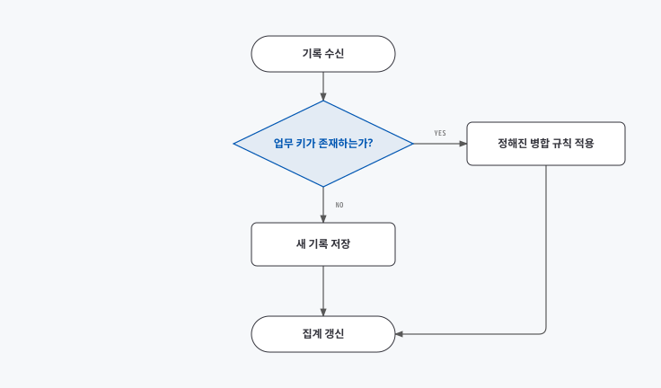{: .light }
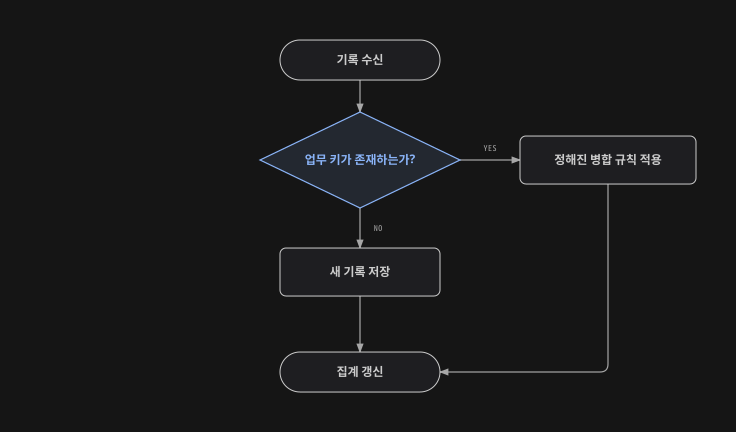{: .dark }
병합 규칙은 제품 정책에 따라 달라집니다. 기술적으로는 정책을 애플리케이션 여러 곳에 흩뜨리지 않고 하나의 명시적인 함수와 테스트로 고정해야 합니다.

---

## 4. 활동 데이터 집계 방식 정하기

통계값을 계산하는 방법은 크게 증분 계산과 전체 재계산으로 나눌 수 있습니다.

| 방식 | 장점 | 주의점 |
|---|---|---|
| 증분 계산 | 새 기록 하나만 반영하므로 빠름 | 수정·지연 도착·재처리 시 보정 로직이 복잡해짐 |
| 전체 재계산 | 원본 데이터가 기준이라 이해하기 쉬움 | 데이터가 커지면 조회와 계산 비용이 증가 |

초기에는 성능을 이유로 증분 집계를 선택하기 쉽습니다. 하지만 데이터가 수정될 수 있다면 각 통계마다 “이전 값을 얼마나 빼고 새 값을 얼마나 더할지”를 관리해야 합니다. 이 보정 로직은 정상 입력보다 예외 입력에서 더 복잡해집니다.

반대로 전체 재계산은 원본 기록을 다시 읽어 결과를 만들기 때문에 일관성을 설명하기 쉽습니다.

~~~typescript
function summarize(samples: ActivitySample[]): ActivitySummary {
  return samples.reduce(
    (summary, sample) => summary.accumulate(sample),
    ActivitySummary.empty(),
  );
}
~~~

어느 방식이 맞는지는 데이터 크기와 수정 빈도에 따라 달라집니다. 다음 질문에는 측정한 값으로 답해야 합니다.

- 사용자 한 명이 가질 수 있는 기록은 얼마나 증가하는가?
- 정정·재전송은 얼마나 자주 발생하는가?
- 집계 지연은 사용자 요청 경로에 포함되는가?
- 데이터베이스 집계 함수로 옮길 수 있는가?

---

## 5. N+1 조회 줄이기

목록 화면에서 구성원마다 통계를 다시 계산하면 목록을 한 번 조회한 후 구성원 수만큼 추가 쿼리가 실행됩니다.

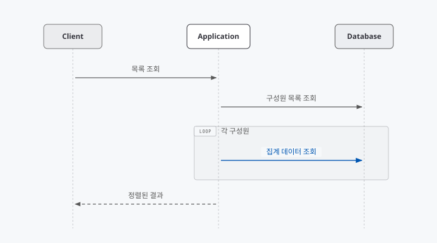{: .light }
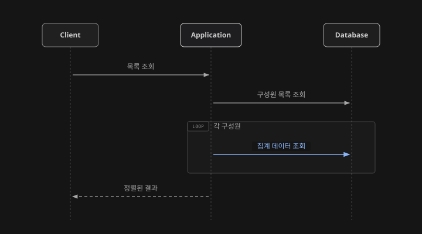{: .dark }
먼저 JOIN과 일괄 조회를 검토했습니다. 같은 결과를 자주 읽는 구간에는 Cache-Aside 방식도 적용할 수 있습니다.

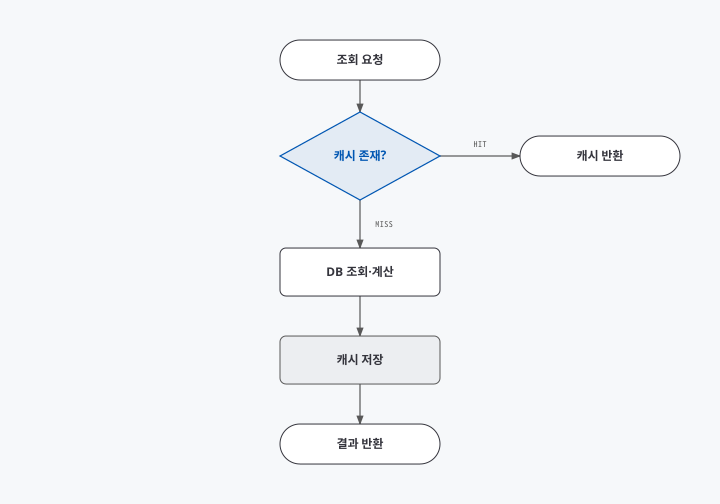{: .light }
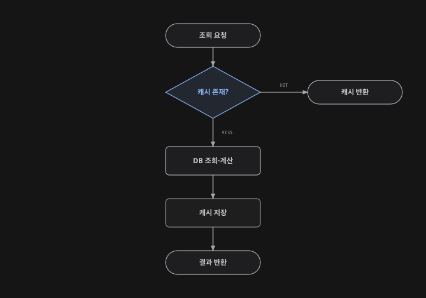{: .dark }
캐시를 도입할 때 확인해야 할 것은 다음과 같습니다.

- 캐시의 소유자는 누구인가?
- 원본 데이터가 바뀌면 언제 무효화하는가?
- TTL만으로 허용 가능한가?
- 캐시 장애 시 DB로 폴백할 수 있는가?
- 정렬·검색이 필요하다면 어떤 자료구조가 맞는가?

캐시는 데이터베이스의 진실을 대체하지 않습니다. 재생성 가능한 파생 데이터만 저장하고 캐시가 비어 있어도 기능이 동작하도록 설계해야 합니다.

---

## 6. Docker와 GitHub Actions로 배포하기

애플리케이션 실행 환경은 Docker 이미지로 만들고 GitHub Actions에서 빌드와 배포가 이어지도록 구성했습니다.

{: .light }
{: .dark }
실무에서 중요하게 지킨 원칙은 다섯 가지였습니다.

1. 빌드와 실행 환경을 분리한다.
2. 비밀값은 이미지 레이어에 포함하지 않는다.
3. 배포 성공을 프로세스 시작이 아니라 상태 확인으로 판정한다.
4. 롤백 가능한 이전 이미지를 유지한다.
5. 애플리케이션 로그를 컨테이너 밖에서 수집한다.

다중 프로세스를 사용할 때는 각 프로세스가 메모리를 독립적으로 사용한다는 점도 고려해야 합니다. 프로세스 수를 CPU 코어 수에만 맞추면 데이터베이스 연결과 메모리 사용량이 예상보다 커질 수 있습니다.

---

## 7. APM으로 느린 구간 확인하기

오류 추적 도구를 통해 발생한 예외는 확인할 수 있었습니다. 하지만 응답이 느린 요청은 예외를 남기지 않는 경우가 많았습니다. 그래서 APM을 함께 연결하여 DB 조회, 캐시, 외부 호출 중 어느 구간에서 시간이 걸리는지 확인했습니다.

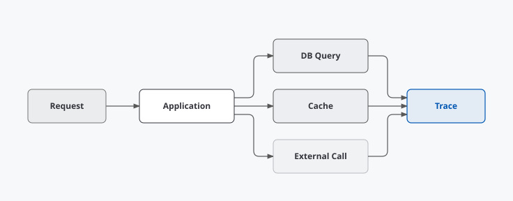{: .light }
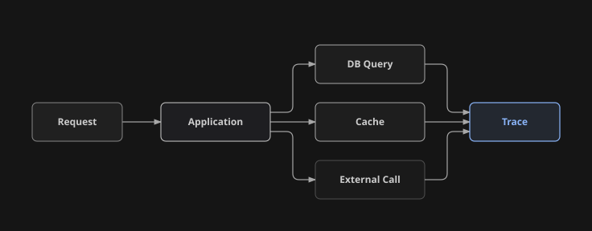{: .dark }
관측성을 적용할 때도 내부 정책과 사용자 정보를 로그에 직접 남기지 않아야 합니다.

- 사용자 식별자는 가명화한다.
- 요청 본문과 토큰은 수집하지 않는다.
- 경로는 템플릿 형태로 정규화한다.
- 고카디널리티 값을 태그로 만들지 않는다.
- 보존 기간과 접근 권한을 최소화한다.

---

## 8. 마무리

찰리와 걷기 백엔드를 개발하면서 정상적인 요청뿐 아니라 중복 입력, 캐시 누락, 느린 조회와 배포 실패까지 함께 고려해야 한다는 점을 배웠습니다.

**중복 입력은 예외가 아니라 입력 특성이다.**

모바일 네트워크에서는 같은 요청이 다시 도착할 수 있으므로 멱등성을 데이터 모델부터 설계해야 합니다.

**캐시는 읽기 성능을 높이지만 일관성 책임을 추가한다.**

캐시를 붙이는 순간 무효화, 장애 폴백, 재생성 전략이 함께 필요합니다.

**집계 방식은 데이터 규모만큼 수정 가능성에도 영향을 받는다.**

증분 계산의 속도만 볼 것이 아니라 보정 로직의 복잡도도 비용으로 계산해야 합니다.

**모니터링은 구현 뒤에 붙이는 장식이 아니다.**

병목과 오류를 찾을 수 있는 신호를 먼저 정의해야 개선 결과도 검증할 수 있습니다.

이번 글에서는 인증, 활동 데이터 저장, 집계, 캐시, 배포와 모니터링까지 백엔드의 전체 흐름을 살펴보았습니다. 각 문제를 확인하고 개선한 과정은 다른 NestJS 프로젝트에서도 활용할 수 있습니다.
