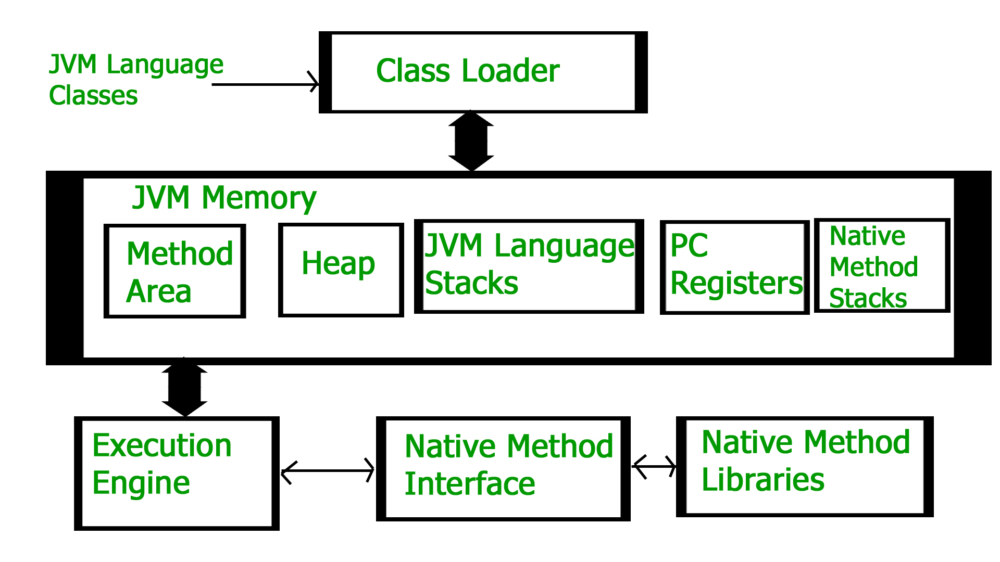
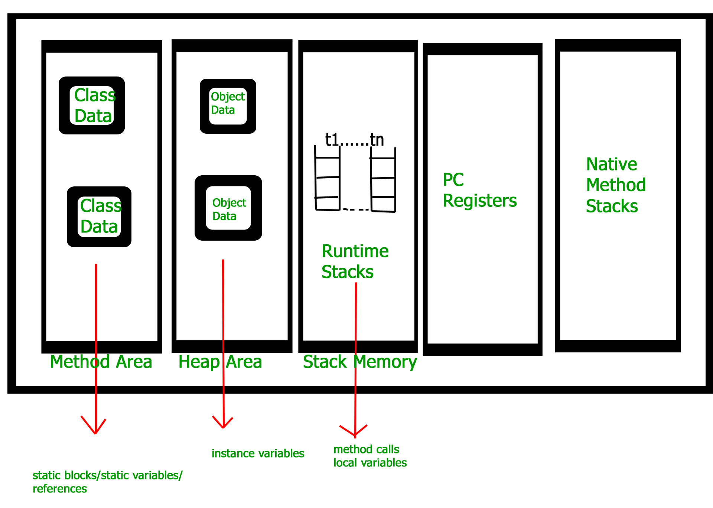

# 계기

스프링 프로젝트를 진행하면서 임시 데이터베이스 구현할때, MySQL과 같은 데이터베이스 서버를 사용하지 않고, 임시로 인메모리에 데이터를 저장하는 방식을 구현하였다. 이때, Database 클래스의 멤버 변수로 엔티티 리스트를 저장할 때 static 키워드를 사용하는 예제를 보고 static 키워드의 의미와 언제 사용해야 하는지 정리하였다.

## 작성한 임시 데이터베이스

```java
public class ItemDB {

    private final Map<Integer, Item> itemMap;

    public ItemDB() {
        this.itemMap = new HashMap<>();
        this.itemMap.put(1, new Item(1,"무한의 대검", 3));
        this.itemMap.put(2, new Item(2,"BF 대검", 2));
        this.itemMap.put(3, new Item(3,"롱소드", 1));
        this.itemMap.put(4, new Item(4,"도란의 검", 1));
    }
    ...
}
```

프로젝트에서 구현한 임시 아이템 데이터베이스는 위와 같은 코드로 되어 있다. 다른 부분보다 주의 깊게 봐야 하는 부분은 `private final Map<Integer, Item> itemMap;` 부분이다. 우리는 `itemMap` 라는 `HashMap<Integer, Item>` 타입으로 구현하였다. 그리고 이 리스트에 각각의 아이템을 저장하였다.

## 예제 데이터베이스

```java
public class MenuInMemoryDatabase {

    private static final Map<Integer, Menu> menuMap = new HashMap<>();
    private MenuInMemoryDatabase() {}
    ...
}
```

그리고 내가 본 예제 데이터베이스이다. 이 예제에서는 `MenuInMemoryDatabase` 클래스의 멤버 변수인 `menuMap`에 `static` 키워드가 들어간걸 볼 수 있다. 이 둘은 어떤 차이가 있는지 알아보았다.

# `Static` 키워드

우리는 대부분 `Static` 키워드를 클래스의 일부 변수를 정적으로 사용하기 위해 사용한다.(값이 변경되지 않는 상수로 사용하길 바란다면 static 키워드와 final 키워드를 같이 사용한다.)

> 정적변수 : 메모리 할당을 한번만 할당되어 프로그램이 종료될때 헤제되는 변수

위와 같이 정적 변수의 정의를 보면 정적 변수는 프로그램이 실행되고 메모리를 한 번만 할당받는다. 정적 변수가 언제 할당되는지 알기 위해서는 JVM의 동작 과정을 알아봐야 한다. 우선 자바 프로그램의 실행 과정을 보자.

> 1. 자바 프로그램을 실행하면 JVM은 OS로부터 메모리를 할당받는다.
> 2. 자바 컴파일러(javac)가 자바 소스코드(.java)를 자바 바이트 코드(.class)로 컴파일 한다.
> 3. Class Loader는 동적 로딩을 통해 필요한 클래스들을 로딩 및 링크 하여 Runtime Data Area(실질적인 메모리를 할당 받아 관리하는 영역)에 올린다.
> 4. Runtime Data Area에 로딩 된 바이트 코드는 Execution Engine을 통해 해석된다.
> 5. 이 과정에서 Execution Engine에 의해 Garbage Collector의 작동과 Thread 동기화가 이루어진다.
>    
>    (이미지 출처 : https://www.geeksforgeeks.org/jvm-works-jvm-architecture/)

### JVM의 메모리 공간(Runtime Data Area)

JVM의 메모리 공간(Runtime Data Area)은 크게 Method(Static) 영역, Stack 영역, Heap 영역으로 구분되고 데이터 타입(자료형)에 따라 각 영역에 나눠 할당된다.

(출처 : https://www.geeksforgeeks.org/jvm-works-jvm-architecture/)

위 이미지에서 Static 변수는 Method Area(Static Area)에서 저장된다. Method Area는 JVM에서 읽어들인 클래스와 인터페이스에 대한 런타임 출, 메서드와 필드, Static 변수, 메서드 바이트 코드 등을 보관한다. 그리고 **JVM 시작 시 생성되며 프로그램 종료 시까지 사용**될 수 있다.(명시적으로 null 선언 시 GC 대상이다.)
위와 같은 Static 변수의 생성 시점 때문에 내가 짠 코드와 예제 사이에 차이가 생긴 것이다.

# 정리

`menuMap` 변수와 같이 `static final` 로 정적 상수 변수를 선언하면 해당 변수는 JVM이 시작 시에 생성된다. 하지만 `itemMap` 변수는 클래스에 final 키워드만으로 상수 변수를 선언하고 해당 변수의 초기화는 해당 클래스가 다른 클래스에 의존성 주입되는 시점에 일어났다.  
이러한 차이점으로 인해 `menuMap` 변수는 해당 클래스의 생성자 안에 변수를 초기화하는 코드도 없다. JVM이 시작되면 해당 클래스를 메모리에 올리면서 `menuMap` 변수도 같이 올리기 때문이다.

## 참고자료

[How JVM Works – JVM Architecture?](https://www.geeksforgeeks.org/jvm-works-jvm-architecture/)  
[JVM 내부 구조 & 메모리 영역 💯 총정리](https://inpa.tistory.com/entry/JAVA-%E2%98%95-JVM-%EB%82%B4%EB%B6%80-%EA%B5%AC%EC%A1%B0-%EB%A9%94%EB%AA%A8%EB%A6%AC-%EC%98%81%EC%97%AD-%EC%8B%AC%ED%99%94%ED%8E%B8#%EB%A9%94%EC%84%9C%EB%93%9C_%EC%98%81%EC%97%AD_method_area)  
[[JVM Internal] JVM 메모리 구조](https://12bme.tistory.com/382)  
[#자바가상머신, JVM(Java Virtual Machine)이란 무엇인가?](https://asfirstalways.tistory.com/158)
