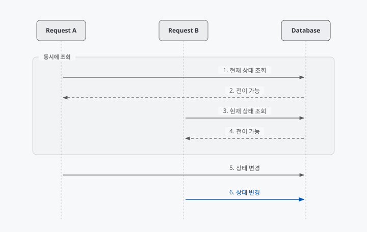
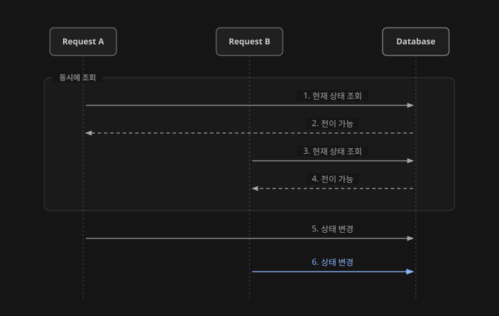
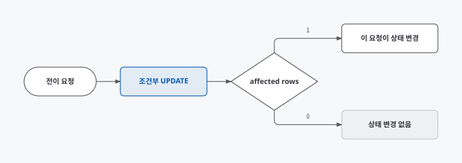
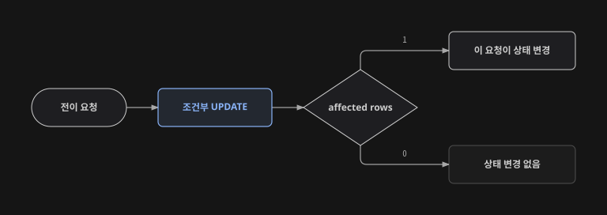
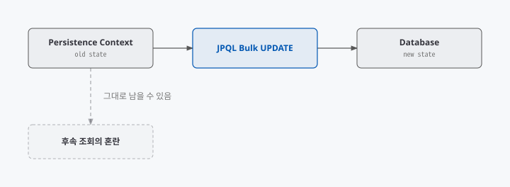
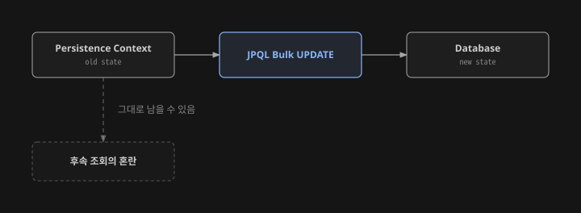
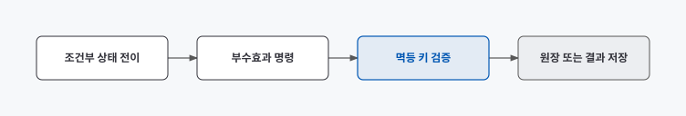
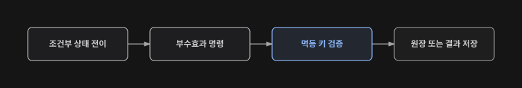

상태를 확인한 후 엔티티를 저장하는 코드는 한 요청만 들어올 때에는 문제없이 동작합니다. 하지만 같은 자원을 여러 요청이 동시에 변경하면 두 요청이 모두 이전 상태를 읽을 수 있습니다.

이번 글에서는 이 문제를 재현하고 Spring Data JPA의 상태 조건 UPDATE로 중복 처리를 막는 과정을 정리해보겠습니다.

> **예제 코드 안내**
>
> 아래의 엔티티·테이블·컬럼·상태·메트릭 이름은 모두 가상 예시입니다. 실제 구현의 상태 전이, API 응답, 재시도, 부분 성공 여부를 설명하지 않으며 특정 서비스 정책과 대응되지 않습니다.
{: .prompt-info }

> **연관 개발기**
>
> 1. **중복 리워드 처리를 막기 위해 상태 조건 UPDATE를 선택한 이유** — 현재 글
> 2. [리워드 생성·수령·충전 책임을 분리한 과정](/posts/reward-creation-receipt-charge-responsibility/)
> 3. [AI 대화 후처리를 요청 트랜잭션에서 분리하기](/posts/ai-conversation-post-processing-pipeline/)
{: .prompt-info }

---

## 1. 조회 후 저장에서 생기는 문제

먼저 자원을 조회한 뒤 애플리케이션에서 상태를 확인하고 저장하는 코드를 작성해보겠습니다.

~~~kotlin
fun process(id: UUID) {
    val item = repository.findById(id)

    if (!item.canTransition()) {
        throw TransitionRejectedException()
    }

    item.transition()
    repository.save(item)
}
~~~

한 요청만 실행될 때는 자연스럽게 동작합니다. 문제는 두 요청이 같은 상태를 동시에 읽을 때입니다.

{: .light }
{: .dark }
각 요청의 검사 코드는 정상적으로 실행됩니다. 문제는 상태를 확인한 시점과 실제로 변경하는 시점 사이에 다른 트랜잭션이 들어올 수 있다는 점입니다.

~~~text
SELECT: 현재 전이 가능한가?
        ↓ 경쟁 요청이 들어올 수 있는 간격
UPDATE: 다음 상태로 변경
~~~

<code>@Transactional</code>은 한 트랜잭션 안의 작업을 묶지만 모든 경쟁 요청을 자동으로 직렬화하지는 않습니다.

---

## 2. WHERE 절에 상태 조건 넣기

그럼 상태 확인과 변경을 하나의 UPDATE 문으로 합쳐보겠습니다.

~~~sql
UPDATE entitlement_example
SET state = :nextState,
    changed_at = :changedAt
WHERE id = :id
  AND state = :expectedState;
~~~

데이터베이스가 반환하는 affected rows는 다음 의미를 갖습니다.

| 결과 | 기술적 의미 |
|---:|---|
| 1 | 이 요청이 조건을 만족한 행을 변경함 |
| 0 | 대상이 없거나 현재 상태가 기대와 다름 |

0행을 API에서 어떻게 응답할지는 따로 정해야 합니다. 예외로 처리할 수도 있고 멱등 성공으로 간주하거나 최신 상태를 돌려줄 수도 있습니다.

{: .light }
{: .dark }
---

## 3. Spring Data JPA 수정 쿼리 작성하기

Spring Data JPA에서는 JPQL 수정 쿼리의 반환 타입을 <code>Int</code>로 선언하여 변경된 행 수를 받을 수 있습니다.

~~~kotlin
@Modifying(clearAutomatically = true)
@Query(
    """
    UPDATE EntitlementEntity e
       SET e.state = :nextState,
           e.updatedAt = :updatedAt
     WHERE e.id = :id
       AND e.state = :expectedState
    """,
)
fun transitionIfCurrent(
    id: UUID,
    expectedState: ExampleState,
    nextState: ExampleState,
    updatedAt: LocalDateTime,
): Int
~~~

수정 쿼리가 성공했는지는 예외 발생 여부가 아니라 변경된 행 수로 판정합니다.

### clearAutomatically 설정하기

JPQL 벌크 UPDATE는 영속성 컨텍스트의 엔티티를 거치지 않고 데이터베이스를 직접 수정합니다.

{: .light }
{: .dark }
<code>clearAutomatically = true</code>를 사용하면 수정 쿼리 뒤 영속성 컨텍스트를 비워 오래된 상태가 다시 사용되는 위험을 줄일 수 있습니다. 다만 이미 변경한 다른 엔티티가 flush되지 않은 상태라면 별도 주의가 필요합니다.

---

## 4. 다른 락 방식과 비교하기

물론 조건부 UPDATE만 사용할 수 있는 것은 아닙니다. 비관적 락과 낙관적 락도 함께 비교해보았습니다.

| 접근 | 장점 | 주의점 |
|---|---|---|
| 조건부 UPDATE | 쿼리가 짧고 경쟁 결과가 행 수로 드러남 | 복잡한 검증을 WHERE에 모두 담기 어려움 |
| 비관적 락 | 조회 이후 긴 검증 흐름을 보호하기 쉬움 | 잠금 대기와 교착 상태 고려 필요 |
| 낙관적 락 | 일반 엔티티 수정 흐름과 결합하기 쉬움 | 충돌 예외와 재시도 정책 필요 |
| 분산 락 | 여러 자원을 아우르는 조정 가능 | 운영 복잡도와 락 유실 고려 필요 |

이번 문제는 상태 하나를 한 방향으로 바꾸는 요청끼리의 경쟁이었기 때문에 가장 단순한 조건부 UPDATE를 선택했습니다. 반면 여러 행을 읽고 복잡한 조건을 검증해야 한다면 다른 전략이 더 적합할 수 있습니다.

---

## 5. 여러 건 UPDATE 결과 확인하기

이제 여러 ID를 한 번에 처리해보겠습니다. 이때 affected rows는 몇 건이 변경됐는지는 알려주지만 어떤 ID가 변경됐는지는 알려주지 않습니다.

~~~sql
UPDATE entitlement_example
SET state = :nextState
WHERE id = ANY(:ids)
  AND state = :expectedState;
~~~

후속 조회로 nextState인 모든 행을 가져오면 다른 요청이 먼저 변경한 행까지 섞일 수 있습니다. 상태 변경 뒤 별도의 부수효과가 이어진다면 이번 요청이 실제로 바꾼 행만 식별해야 합니다.

### UPDATE RETURNING 사용하기

PostgreSQL에서는 실제 갱신한 행의 식별자를 반환할 수 있습니다.

~~~sql
UPDATE entitlement_example
SET state = :nextState
WHERE id = ANY(:ids)
  AND state = :expectedState
RETURNING id;
~~~

승자 집합을 정확하게 얻을 수 있지만 네이티브 쿼리와 결과 매핑 때문에 데이터베이스 종속성이 생깁니다.

### ID별로 조건부 UPDATE 실행하기

~~~kotlin
val transitionedIds =
    ids.filter { id ->
        repository.transitionIfCurrent(
            id = id,
            expectedState = expected,
            nextState = next,
            updatedAt = now,
        ) == 1
    }
~~~

구현은 단순하지만 요청 수가 늘어납니다. 처리 대상의 상한과 호출 빈도를 측정해 판단해야 합니다.

### 작업 토큰 남기기

상태 변경과 함께 요청별 토큰을 기록하고 그 토큰으로 다시 조회할 수도 있습니다.

~~~sql
UPDATE entitlement_example
SET state = :nextState,
    operation_token = :operationToken
WHERE id = ANY(:ids)
  AND state = :expectedState;
~~~

스키마 변경이 필요하지만 처리 추적에도 사용할 수 있습니다.

---

## 6. 후속 작업의 중복 막기

상태 변경 이후에는 다른 저장 작업이나 알림 같은 후속 작업이 이어질 수 있습니다. 상태 UPDATE가 한 번만 성공하더라도 후속 작업까지 자동으로 한 번만 실행되는 것은 아닙니다.

{: .light }
{: .dark }
그래서 부수효과를 기록하는 쪽에도 출처 식별자로 유일 제약을 둘 수 있습니다.

~~~sql
CREATE UNIQUE INDEX uq_example_effect_source
ON effect_ledger_example (
    source_kind,
    source_key,
    effect_kind
)
WHERE deleted = false;
~~~

핵심은 같은 원인으로 동일한 부수효과가 두 번 기록되지 않도록 데이터베이스에도 방어선을 두는 것입니다.

---

## 7. 동시성 테스트 작성하기

코드를 수정한 후에는 여러 작업이 최대한 같은 시점에 시작하도록 동시성 테스트를 작성했습니다.

~~~kotlin
val ready = CountDownLatch(workerCount)
val start = CountDownLatch(1)

repeat(workerCount) {
    executor.submit {
        ready.countDown()
        start.await()
        runCatching { service.process(exampleId) }
    }
}

ready.await()
start.countDown()
~~~

테스트에서는 다음 불변식을 검증했습니다.

- 허용된 상태 변경 횟수는 기대 범위를 넘지 않는다.
- 동일한 원인의 부수효과가 중복 저장되지 않는다.
- 최종 집계값은 고유한 성공 집합과 일치한다.
- 경쟁에서 실패한 요청이 추가 부수효과를 만들지 않는다.

---

## 8. 운영 지표 확인하기

운영 지표는 다음 범주로 나누어 볼 수 있습니다.

| 범주 | 의미 |
|---|---|
| transition.success | 조건부 변경 성공 |
| transition.conflict | 기대 상태 불일치 |
| effect.success | 후속 부수효과 완료 |
| effect.duplicate | 멱등성 제약 충돌 |
| consistency.mismatch | 상태 변경과 원장 수 불일치 |

충돌 자체는 항상 오류가 아닙니다. 모바일 재시도나 중복 요청에서 정상적으로 발생할 수 있습니다. 평소 비율에서 크게 벗어날 때만 조사할 수 있도록 기준선을 먼저 관측해야 합니다.

---

## 9. 마무리

**트랜잭션은 경쟁을 자동으로 없애지 않는다.**

두 요청이 각각 올바른 트랜잭션 안에서 동작해도 같은 이전 상태를 읽을 수 있습니다.

**판정은 데이터에 가장 가까운 곳에서 원자적으로 수행한다.**

조회와 변경을 하나의 UPDATE로 합치면 Check-Then-Act의 경쟁 창을 줄일 수 있습니다.

**affected rows는 업무 흐름의 입력이 될 수 있다.**

행 수를 무시하지 않고 다음 단계의 실행 여부를 결정하는 값으로 사용하면 흐름이 명확해집니다.

**상태 전이와 부수효과는 각각 멱등해야 한다.**

한 계층의 방어만 믿지 않고 원장이나 결과 저장소에도 유일성을 둬야 합니다.

이번 글에서는 조회 후 저장에서 발생할 수 있는 동시성 문제를 확인하고 상태 조건 UPDATE와 변경 행 수를 이용해 처리 결과를 구분해보았습니다. 같은 상태를 여러 요청이 동시에 변경하는 기능이라면 동일한 방식으로 검토할 수 있습니다.
