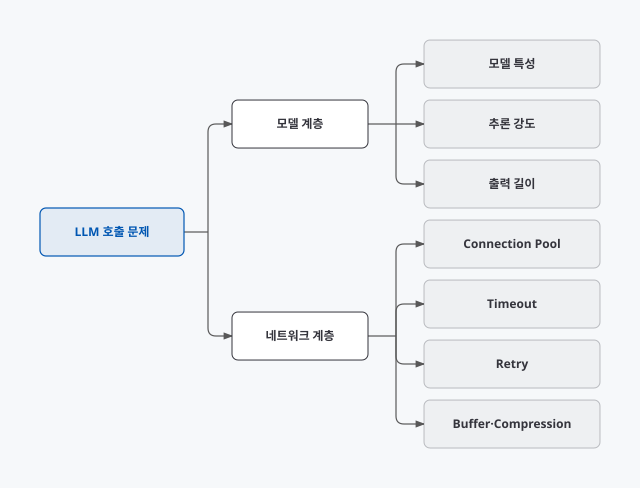
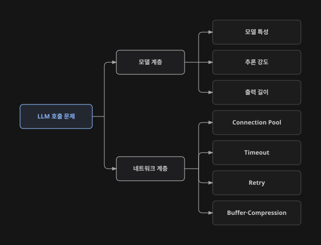
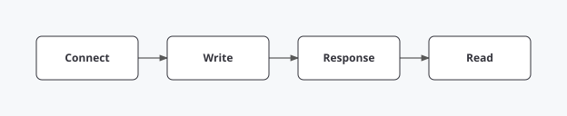
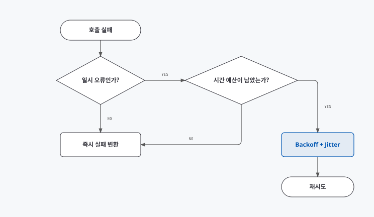
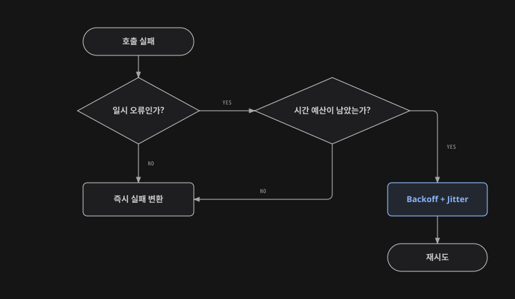
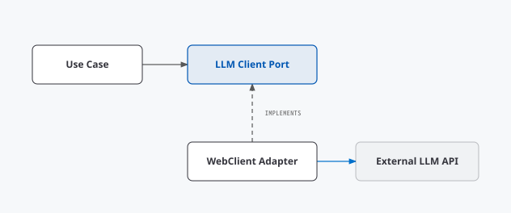
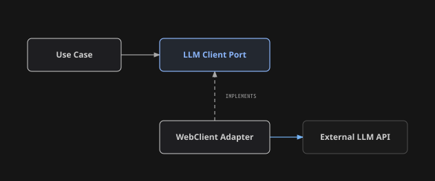

Kotlin과 Spring WebClient로 OpenAI API를 호출하면서 모델 응답 시간뿐 아니라 연결 생성, 타임아웃과 재시도 설정도 전체 처리 시간에 영향을 준다는 점을 확인했습니다.

이번 글에서는 모델을 비교한 방법부터 Reactor Netty의 Connection Pool과 타임아웃을 설정한 과정까지 순서대로 정리해보겠습니다.

> **예제 코드 안내**
>
> 모든 모델 이름은 A·B 같은 가상 명칭으로, 모든 설정은 프로퍼티 이름으로 표현했습니다. 표의 결과도 실제 측정값이 아니라 비교 방법을 설명하기 위한 상대 평가입니다.
{: .prompt-info }

---

## 1. 느린 구간 나누어 보기

먼저 API 호출이 느려지는 구간을 모델과 네트워크로 나누어보았습니다.

{: .light }
{: .dark }
모델 계층은 응답 생성 자체의 비용을 결정합니다. 네트워크 계층은 연결 수립, 대기, 장애 전파, 응답 수신을 제어합니다. 두 층을 분리해서 측정해야 “모델이 느린 것”과 “호출 방식이 비효율적인 것”을 구분할 수 있습니다.

---

## 2. 모델 비교하기

모델을 비교할 때에는 간단한 일반 질문보다 애플리케이션에서 사용하는 입력과 비슷한 예제가 필요했습니다. 평가 항목은 다섯 가지로 정했습니다.

| 평가 항목 | 확인할 내용 |
|---|---|
| 품질 | 필수 정보 누락, 형식 위반, 사실성 |
| 지연 | 평균보다 p50·p95·최댓값 |
| 비용 | 입력·출력 토큰과 호출 빈도 |
| 안정성 | 빈 응답, 파싱 실패, 일시 오류 |
| 일관성 | 같은 유형 입력에서 결과 편차 |

비교 결과는 다음처럼 상대적으로 기록할 수 있습니다.

| 후보 | 품질 | 지연 | 비용 | 판단 |
|---|---|---|---|---|
| Model A | 기준 | 기준 | 기준 | 비교 기준 |
| Model B | 동등 | 더 짧음 | 더 낮음 | 후보 |
| Model C | 더 높음 | 더 김 | 더 높음 | 복잡한 작업용 |

중요한 것은 하나의 숫자로 모델을 선택하지 않고 품질·지연·비용·안정성을 함께 비교하는 방식입니다.

### 추론 설정 나누기

추론 옵션을 지원하는 모델이라면 복잡한 논리 작업과 단순 변환 작업을 같은 설정으로 호출할 필요가 없습니다.

~~~kotlin
data class ModelPolicy(
    val modelAlias: String,
    val reasoningLevel: String?,
    val maxOutputTokens: Int,
)

fun createRequest(
    input: List<Message>,
    policy: ModelPolicy,
): CompletionRequest =
    CompletionRequest(
        model = policy.modelAlias,
        messages = input,
        reasoningEffort = policy.reasoningLevel,
        maxCompletionTokens = policy.maxOutputTokens,
    )
~~~

구체적인 별칭과 값은 외부 설정이나 모델 정책 저장소에서 주입합니다. 코드 리뷰에서는 값보다 “어떤 작업이 어떤 정책을 선택하는가”와 “변경 시 품질 검증이 있는가”를 확인합니다.

---

## 3. Connection Pool 설정하기

그다음은 HTTP 연결을 확인했습니다. 요청마다 새 연결을 만들면 TCP와 TLS 연결 과정이 반복됩니다. Reactor Netty의 <code>ConnectionProvider</code>를 사용하여 기존 연결을 다시 사용할 수 있습니다.

~~~kotlin
val connectionProvider =
    ConnectionProvider.builder("llm-pool")
        .maxConnections(network.poolCapacity)
        .maxIdleTime(network.idleTimeout)
        .maxLifeTime(network.connectionLifetime)
        .pendingAcquireTimeout(network.acquireTimeout)
        .evictInBackground(network.evictionInterval)
        .build()
~~~

각 값은 다음 근거로 정합니다.

| 설정 | 결정 근거 |
|---|---|
| Pool capacity | 동시 요청량, 외부 API 한도, 인스턴스 자원 |
| Idle timeout | 서버 keep-alive와 유휴 연결 오류 |
| Connection lifetime | 오래된 연결의 실패율 |
| Acquire timeout | 사용자 요청의 전체 시간 예산 |
| Eviction interval | 유휴 연결 정리 비용 |

이 값들은 다른 서비스의 설정을 그대로 가져오기보다 직접 측정해서 정해야 합니다. 트래픽과 실행 환경이 다르면 같은 값이 오히려 장애를 만들 수 있기 때문입니다.

---

## 4. 단계별 타임아웃 설정하기

Connection Pool을 설정한 후 연결, 쓰기, 응답 대기와 읽기 타임아웃을 각각 나누었습니다. 요청 전체에 하나의 타임아웃만 두면 어느 단계에서 멈췄는지 확인하기 어렵기 때문입니다.

{: .light }
{: .dark }
~~~kotlin
val httpClient =
    HttpClient.create(connectionProvider)
        .option(
            ChannelOption.CONNECT_TIMEOUT_MILLIS,
            network.connectTimeoutMillis,
        )
        .responseTimeout(network.responseTimeout)
        .doOnConnected { connection ->
            connection.addHandlerLast(
                ReadTimeoutHandler(network.readTimeoutSeconds),
            )
            connection.addHandlerLast(
                WriteTimeoutHandler(network.writeTimeoutSeconds),
            )
        }
        .compress(true)
~~~

타임아웃 값은 모델별 지연 분포와 사용자 요청의 시간 예산을 기준으로 결정합니다. 너무 짧으면 정상 응답을 실패로 만들고 너무 길면 느린 외부 호출이 서버 자원을 오래 점유합니다.

---

## 5. 응답 버퍼와 압축 설정하기

OpenAI 응답은 일반적인 JSON API보다 커질 수 있습니다. WebClient의 메모리 버퍼를 설정할 때에는 예상 응답 크기와 동시에 처리하는 요청 수를 함께 확인했습니다.

~~~kotlin
val strategies =
    ExchangeStrategies.builder()
        .codecs { codecs ->
            codecs.defaultCodecs()
                .maxInMemorySize(network.maxInMemoryBytes)
        }
        .build()
~~~

버퍼를 크게 만들면 모든 문제가 해결되는 것은 아닙니다. 동시 요청 수와 곱해지면 메모리 사용량이 커지므로 다음을 함께 확인해야 합니다.

- 출력 토큰 상한
- 응답 스트리밍 가능 여부
- 동시 요청량
- 역직렬화 전 원문 보관 여부
- 초과 응답의 실패 처리

gzip은 텍스트 응답의 전송량을 줄일 수 있지만 실제 효과는 응답 크기와 네트워크 환경을 측정해 판단해야 합니다.

---

## 6. 재시도 조건 정하기

이제 실패한 요청의 재시도 조건을 정해보겠습니다. 같은 요청을 다시 보내면 성공할 수 있는 일시 오류만 재시도 대상으로 두어야 합니다. 잘못된 요청이나 인증 실패를 반복하면 외부 API와 서버에 불필요한 부하만 추가됩니다.

~~~kotlin
fun retrySpec(policy: RetryPolicy): Retry =
    Retry.backoff(policy.maxAttempts, policy.initialBackoff)
        .maxBackoff(policy.maxBackoff)
        .jitter(policy.jitter)
        .filter(::isTransientFailure)
~~~

{: .light }
{: .dark }
구체적인 오류 목록과 횟수는 외부 API 계약과 사용자 SLA에 따라 달라집니다.

### 같은 시점의 재시도 분산하기

여러 요청이 동시에 실패한 뒤 같은 간격으로 재시도하면 외부 API에 다시 부하가 집중됩니다. 지수 백오프에 jitter를 추가하면 재시도 시점을 분산할 수 있습니다.

---

## 7. WebClient 예외 변환하기

WebClient 예외를 애플리케이션 안쪽까지 그대로 전달하면 코어 로직이 HTTP와 Reactor 타입에 의존하게 됩니다. 그래서 외부 API 어댑터에서 제한된 실패 타입으로 변환했습니다.

~~~kotlin
sealed interface LlmFailure {
    data object TimedOut : LlmFailure
    data object RateLimited : LlmFailure
    data object InvalidResponse : LlmFailure
    data class Unavailable(val cause: Throwable) : LlmFailure
}
~~~

어댑터가 외부 오류를 제한된 실패 타입으로 바꾸면 상위 계층은 다음 행동만 결정하면 됩니다.

- 사용자에게 재시도 가능 여부를 안내할지
- 대체 경로를 사용할지
- 비동기 보정 대상으로 남길지
- 운영 알림을 보낼지

---

## 8. 호출 결과 기록하기

LLM 호출 로그에는 최소한 다음과 같은 기술 지표가 필요합니다.

| 필드 종류 | 예시 |
|---|---|
| 작업 구분 | 기능 별칭 |
| 모델 구분 | 모델 그룹 |
| 시간 | 전체 지연, 재시도 지연 |
| 사용량 | 입력·출력 토큰 |
| 결과 | 성공, 시간 초과, 제한, 파싱 실패 |

프롬프트와 응답 원문은 개인정보와 내부 정책을 포함할 수 있으므로 기본 수집 대상으로 두지 않습니다. 필요하다면 마스킹, 샘플링, 접근 권한, 보존 기간을 함께 설계해야 합니다.

---

## 9. 외부 호출을 Port로 분리하기

~~~kotlin
interface LlmClientPort {
    fun complete(
        messages: List<Message>,
        policyKey: String,
    ): LlmResult
}
~~~

코어는 WebClient, 커넥션 풀, 모델 공급자, 재시도 구현을 알지 않습니다. 인프라 어댑터가 정책 키를 외부 API 요청으로 변환합니다.

{: .light }
{: .dark }
이 경계를 두면 모델 공급자나 네트워크 라이브러리를 바꿔도 코어 로직의 변경을 줄일 수 있고 테스트에서는 포트를 대역으로 교체할 수 있습니다.

---

## 10. 마무리

1. 실제 작업과 비슷한 입력으로 모델을 비교합니다.
2. 품질·지연·비용·안정성을 함께 봅니다.
3. 연결 풀과 타임아웃을 실행 환경에 맞춰 외부 설정으로 분리합니다.
4. 재시도는 일시 오류에 한해, 전체 시간 예산 안에서만 허용합니다.
5. 외부 API 예외와 구현 세부사항을 어댑터 경계 안에 둡니다.
6. 프롬프트와 운영 정책이 관측 데이터로 새지 않도록 합니다.

이번 글에서는 모델 비교부터 Connection Pool, 타임아웃, 버퍼, 재시도와 예외 변환까지 OpenAI API 호출의 전체 흐름을 살펴보았습니다. 예제의 모델명과 설정값은 임의로 바꾸었지만 WebClient 호출이 느리거나 불안정할 때 확인하는 순서는 그대로 적용할 수 있습니다.
