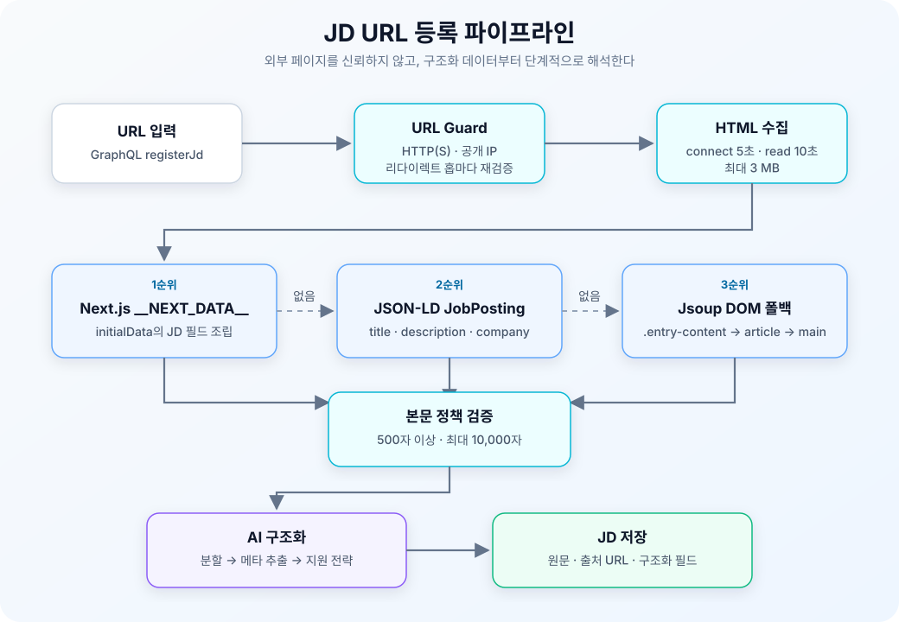
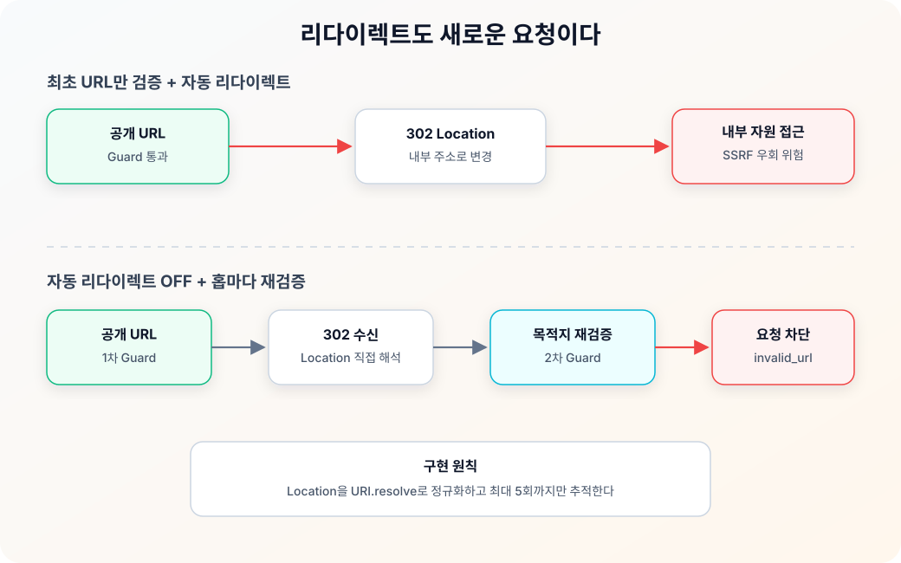

Jobdori는 채용 공고(JD)를 바탕으로 지원 전략과 이력서를 만드는 서비스입니다. 이 서비스에 채용 공고를 등록할 때 긴 본문을 직접 복사하지 않고 URL만 입력할 수 있도록 크롤러를 구현했습니다.

처음에는 URL을 요청하고 Jsoup의 `body.text()`를 반환하면 끝날 것으로 생각했습니다. 하지만 사이트마다 HTML 구조가 달랐습니다. Next.js 페이지는 `__NEXT_DATA__`에 데이터를 넣었고, 다른 페이지는 schema.org의 `JobPosting` JSON-LD를 제공했습니다. 일반 HTML에서는 메뉴와 푸터, 사이드바가 본문에 함께 들어왔습니다.

또한 서버가 사용자가 입력한 URL을 대신 요청하기 때문에 SSRF(Server-Side Request Forgery)도 막아야 했습니다. 최초 URL만 검사하면 리다이렉트가 내부 주소를 가리키는 경우 검사를 우회할 수 있었습니다.

이번 글에서는 본문 추출, URL 검증과 서비스 연결 순서로 JD 크롤러를 구현한 과정을 정리해보겠습니다.

1. **본문 추출 정확도**: `__NEXT_DATA__` → JSON-LD `JobPosting` → Jsoup DOM 순서의 폴백 파이프라인
2. **네트워크 안전성**: URL·IP 검증, 리다이렉트 홉별 재검증, 타임아웃과 응답 크기 제한
3. **서비스 통합**: Core Port 분리, GraphQL 오류 계약, 직접 붙여넣기 폴백, 구조화 로그와 테스트

> 예제의 제한값, User-Agent, 오류 코드, 프롬프트 키와 테스트 경로는 임의로 바꾸었습니다.
{: .prompt-info }

---

## 1. JD 등록 흐름 확인하기

### 1.1 URL 등록 이후의 작업

사용자가 URL로 JD를 등록하면 백엔드에서는 다음 작업이 이어집니다.

| 단계 | 처리 내용 | 실패 시 영향 |
|---|---|---|
| URL 수집 | 외부 채용 페이지의 HTML 다운로드 | 공고 본문을 얻을 수 없음 |
| 본문 정제 | 메뉴·푸터를 제거하고 JD 텍스트 구성 | AI 입력에 노이즈가 섞임 |
| 다중 공고 분할 | 한 본문에 여러 공고가 있는지 판별 | 서로 다른 공고가 하나로 저장됨 |
| 메타 추출 | 기업명, 포지션, 업무, 자격요건 등을 구조화 | 검색·추천에 필요한 필드가 비어 있음 |
| 지원 전략 생성 | 프로필과 JD를 함께 분석 | JD 등록 결과가 불완전해짐 |
| 저장 | 원문, 출처 URL, 구조화 필드 저장 | 이후 이력서 생성 흐름을 시작할 수 없음 |

크롤러의 출력은 단순히 화면에 보여 줄 문자열이 아닙니다. 이후 AI 메타 추출과 지원 전략 생성의 입력이 되기 때문에, **본문을 충분히 길게 가져오는 것과 불필요한 텍스트를 덜 섞는 것**이 모두 중요했습니다.

### 1.2 사이트별 HTML 구조 확인하기

확인한 페이지 구조는 크게 세 가지였습니다.

| 페이지 유형 | 데이터 위치 | 일반적인 DOM 텍스트 추출의 한계 |
|---|---|---|
| Next.js 기반 페이지 | `script#__NEXT_DATA__`의 `props.pageProps.initialData` | 동적으로 렌더링되는 우대사항·전형 절차가 빠질 수 있음 |
| 구조화 데이터 제공 페이지 | `script[type=application/ld+json]`의 `JobPosting` | JSON을 읽지 않으면 구조화된 제목·설명을 활용하지 못함 |
| 일반 정적 HTML | `.entry-content`, `article`, `main`, `body` | 메뉴·사이드바·푸터가 본문에 섞일 수 있음 |

특정 사이트의 CSS 클래스 하나에 의존하면 그 사이트의 마크업 변경에 바로 깨집니다. 반대로 `body.text()`만 사용하면 넓게 동작하지만 품질이 낮습니다. 그래서 **구조화된 데이터가 있으면 우선 사용하고, 없을 때만 범용 DOM 추출로 내려가는 방식**을 선택했습니다.

### 1.3 실패 조건 정하기

구현 전에 크롤 성공 조건뿐 아니라 실패 조건도 함께 정리했습니다.

- `http`, `https` URL만 허용한다.
- 루프백·링크 로컬·사설·멀티캐스트 주소는 요청하지 않는다.
- 리다이렉트 목적지도 같은 규칙으로 다시 검증한다.
- 연결과 응답을 무기한 기다리지 않는다.
- 큰 응답을 메모리에 끝없이 적재하지 않는다.
- 구조화 데이터가 없으면 일반 HTML 본문으로 폴백한다.
- 최종 본문이 너무 짧으면 성공으로 간주하지 않는다.
- 수집할 수 없는 페이지는 사용자가 원문을 붙여 넣을 수 있도록 명확한 오류를 반환한다.

이 요구사항 덕분에 크롤러의 책임이 선명해졌습니다. 크롤러는 JD의 의미를 판단하거나 저장하지 않습니다. **안전하게 URL을 읽고, 후속 처리에 사용할 수 있는 본문 문자열을 반환하는 것**까지만 담당합니다.

---

## 2. 크롤러 Port 만들기

### 2.1 Infrastructure에 구현하기

Jobdori 백엔드의 컴파일 의존 방향은 다음과 같습니다.

```text
jobdori-api → jobdori-core → jobdori-common
jobdori-infrastructure → jobdori-core → jobdori-common
```

HTTP 클라이언트와 Jsoup은 외부 시스템을 다루는 구현 세부입니다. Core가 이 기술을 직접 알게 하면 비즈니스 유스케이스가 네트워크 라이브러리에 묶입니다. 그래서 Core에는 작은 포트만 정의했습니다.

```kotlin
/** JD URL에서 본문 텍스트를 수집하는 포트. 실패 시 JdCrawlException. */
interface JdCrawlerClient {
    fun fetchBody(url: String): String
}
```

Infrastructure의 `StaticJdCrawlerClient`가 이 인터페이스를 구현합니다.

```kotlin
@Component
class StaticJdCrawlerClient(
    private val properties: JdCrawlerProperties,
    private val urlGuard: JdUrlGuard,
    private val nextDataJdParser: NextDataJdParser,
    private val jsonLdJdParser: JsonLdJdParser,
) : JdCrawlerClient
```

이 구조에서는 `RegisterJdService`가 크롤링 방식이 Jsoup인지, 브라우저 자동화인지 알 필요가 없습니다. 나중에 동적 렌더링 전용 구현을 추가하더라도 Core의 유스케이스 계약은 유지할 수 있습니다.

### 2.2 URL 입력과 본문 입력 합치기

사용자는 URL 또는 직접 붙여 넣은 본문으로 JD를 등록할 수 있습니다.

```kotlin
fun registerByUrl(workspaceId: Long, url: String): JdRegisterResult {
    validateActiveExperienceExists(workspaceId)
    return register(
        workspaceId,
        sourceUrl = url,
        body = crawler.fetchBody(url),
    )
}

fun registerByText(
    workspaceId: Long,
    body: String,
    sourceUrl: String? = null,
): JdRegisterResult {
    validateActiveExperienceExists(workspaceId)
    return register(workspaceId, sourceUrl, body)
}
```

입력 경로는 다르지만, 본문을 얻은 뒤에는 같은 `register` 로직을 거칩니다. 크롤 실패 후 사용자가 직접 붙여 넣어도 다중 공고 분할, 메타 추출, 지원 전략 생성, 저장 규칙이 달라지지 않습니다.

GraphQL Resolver에서는 `body`를 우선합니다.

```kotlin
val result = if (!request.body.isNullOrBlank()) {
    registerJdService.registerByText(
        workspace.id,
        request.body,
        request.sourceUrl,
    )
} else {
    registerJdService.registerByUrl(
        workspace.id,
        request.sourceUrl!!,
    )
}
```

다중 공고 중 하나를 골라 본문으로 다시 등록할 때도 `sourceUrl`을 출처 메타데이터로 보존할 수 있습니다.

---

## 3. 본문 추출 순서 정하기

### 3.1 파서 순서 구성하기

HTML을 한 번 가져온 뒤 세 파서를 순서대로 시도합니다.

```kotlin
val html = fetchHtml(url)

val body = nextDataJdParser.parse(url, html)
    ?: jsonLdJdParser.parse(url, html)
    ?: extractText(html, url)
```

각 파서는 자신이 이해할 수 없는 문서라면 예외를 퍼뜨리지 않고 `null`을 반환합니다. 덕분에 사이트별 조건문을 하나의 거대한 클래스에 쌓지 않고, 파서마다 책임을 나눌 수 있었습니다.



<small>한 번 수집한 HTML을 `__NEXT_DATA__`, JSON-LD, 일반 DOM 순서로 해석하고, 충분한 본문만 후속 AI 파이프라인에 전달한다.</small>

### 3.2 Next.js `__NEXT_DATA__` 읽기

일부 Next.js 채용 페이지는 화면 렌더링에 사용할 원본 데이터를 `script#__NEXT_DATA__`에 포함합니다. DOM에 보이는 텍스트보다 필드 경계가 명확하고, 클라이언트 렌더링 과정에서 나타나는 우대사항이나 채용 전형도 얻을 수 있습니다.

```kotlin
private fun extractNextData(
    html: ByteArray,
    url: String,
): String? =
    Jsoup.parse(ByteArrayInputStream(html), null, url)
        .selectFirst("script#__NEXT_DATA__")
        ?.data()
        ?.takeIf { it.isNotBlank() }
```

JSON 전체를 `Map<String, Any>`로 탐색하는 대신, 실제로 필요한 경로만 DTO로 정의했습니다.

```kotlin
@JsonIgnoreProperties(ignoreUnknown = true)
data class NextData(val props: Props? = null) {

    @JsonIgnoreProperties(ignoreUnknown = true)
    data class Props(val pageProps: PageProps? = null)

    @JsonIgnoreProperties(ignoreUnknown = true)
    data class PageProps(val initialData: InitialData? = null)

    @JsonIgnoreProperties(ignoreUnknown = true)
    data class InitialData(
        val position: String? = null,
        val company: Company? = null,
        val intro: String? = null,
        @JsonProperty("main_tasks") val mainTasks: String? = null,
        val requirements: String? = null,
        @JsonProperty("preferred_points") val preferredPoints: String? = null,
        @JsonProperty("hire_rounds") val hireRounds: String? = null,
        val benefits: String? = null,
    )
}
```

`@JsonIgnoreProperties(ignoreUnknown = true)`를 적용해 페이지 데이터에 다른 필드가 추가돼도 필요한 JD 필드가 유지되는 한 파싱할 수 있게 했습니다.

추출 결과는 라벨이 있는 일반 텍스트로 조립합니다.

```text
[포지션]
백엔드 개발자

[기업명]
잡도리

[주요업무]
Kotlin과 Spring Boot 기반 API 개발

[자격요건]
서버 애플리케이션 개발 경험
```

이 텍스트가 후속 메타 추출 프롬프트의 입력이 됩니다. 사이트별 JSON을 AI가 직접 해석하게 두지 않고, 크롤러 단계에서 공통 형식으로 정규화했습니다.

### 3.3 `JobPosting` JSON-LD 읽기

Next.js 전용 데이터가 없는 페이지에서는 `application/ld+json` 스크립트를 확인합니다. JSON-LD의 루트 형태는 한 가지가 아니었습니다.

```json
{ "title": "Backend Engineer", "description": "..." }
```

```json
[
  { "title": "Backend Engineer", "description": "..." }
]
```

```json
{
  "@graph": [
    { "title": "Backend Engineer", "description": "..." }
  ]
}
```

파서는 단일 객체, 배열, `@graph`를 모두 후보 시퀀스로 펼칩니다.

```kotlin
val candidates = when {
    root.isArray -> root.toList()
    root.has("@graph") && root.get("@graph").isArray ->
        root.get("@graph").toList()
    else -> listOf(root)
}

return candidates.asSequence()
    .mapNotNull { node ->
        runCatching {
            JsonUtils.DEFAULT_JSON_MAPPER.treeToValue(
                node,
                JobPosting::class.java,
            )
        }.getOrNull()
    }
    .filter {
        !it.title.isNullOrBlank() &&
            !it.description.isNullOrBlank()
    }
```

현재 구현은 `@type`이 문자열 또는 배열로 표현되는 편차를 직접 분기하는 대신, 실제로 사용할 `title`과 `description`이 모두 있는 후보를 선택합니다. 파싱 실패도 해당 스크립트 하나의 실패로 제한하고 다음 후보나 DOM 폴백으로 넘어갑니다.

`description`은 HTML인 경우가 많아 그대로 사용하지 않았습니다. `<br>`, `</p>`, `</li>`, 제목·목록·섹션 종료 태그를 먼저 줄바꿈으로 바꾸고, 나머지 태그와 HTML 엔티티를 정리했습니다.

```kotlin
private fun htmlToText(descriptionHtml: String): String =
    descriptionHtml
        .replace(Regex("(?i)<br\\s*/?>"), "\n")
        .replace(
            Regex("(?i)</(p|li|h[1-6]|div|ul|ol|tr|section)>"),
            "\n",
        )
        .replace(Regex("<[^>]+>"), " ")
        .let { Parser.unescapeEntities(it, false) }
        .replace(Regex("[ \\t]+"), " ")
        .replace(Regex("\\s*\n\\s*"), "\n")
        .trim()
```

태그만 단순 제거하면 문단과 목록이 한 줄로 붙습니다. 블록 태그의 경계를 줄바꿈으로 먼저 보존한 이유입니다.

### 3.4 일반 DOM에서 본문 찾기

구조화 데이터가 없는 페이지는 Jsoup으로 DOM을 파싱합니다. 먼저 공고 본문일 가능성이 낮은 요소를 제거합니다.

```kotlin
private val noiseSelector =
    "style, noscript, nav, footer, aside, iframe, " +
        "svg, form, button, input, select"

document.select(noiseSelector).remove()
```

초기 구현은 노이즈 요소를 제거한 뒤 전체 `body.text()`를 반환했습니다.

```kotlin
val body = document
    .apply { select(noiseSelector).remove() }
    .body() ?: return ""

return body.text().trim()
```

이 방식은 범용적이지만 워드프레스처럼 메뉴나 사이드바가 `nav`, `aside` 바깥에 있는 페이지에서는 불필요한 텍스트가 남았습니다. 실제 페이지를 확인한 뒤 본문 컨테이너 우선순위를 추가했습니다.

```kotlin
private val contentSelectors = listOf(
    ".entry-content",
    "article",
    "main",
)

val main = contentSelectors.asSequence()
    .mapNotNull {
        document.selectFirst(it)?.text()?.trim()
    }
    .firstOrNull {
        it.length >= properties.minBodyLength
    }

return main ?: body.text().trim()
```

중요한 점은 컨테이너를 찾았다는 이유만으로 바로 사용하지 않는 것입니다. 컨테이너 텍스트가 최소 본문 길이를 만족할 때만 선택하고, 너무 짧으면 전체 `body`로 폴백합니다. 정확도를 높이면서도 특정 마크업에 지나치게 묶이지 않도록 한 절충입니다.

---

## 4. HTTP 요청 제한하기

### 4.1 `RestClient` 타임아웃 설정하기

크롤링은 JD 등록 요청 안에서 한 페이지를 가져오는 동기 흐름입니다. HTTP 상태와 응답 스트림을 직접 다뤄야 했기 때문에 Spring `RestClient.exchange`를 사용했습니다.

```kotlin
private val restClient = RestClient.builder()
    .requestFactory(
        object : SimpleClientHttpRequestFactory() {
            override fun prepareConnection(
                connection: HttpURLConnection,
                httpMethod: String,
            ) {
                super.prepareConnection(connection, httpMethod)
                connection.instanceFollowRedirects = false
            }
        }.apply {
            setConnectTimeout(properties.connectTimeout)
            setReadTimeout(properties.readTimeout)
        },
    )
    .build()
```

| 설정 | 값 결정 기준 | 방어하려는 상황 |
|---|---:|---|
| Connect timeout | 네트워크 관측값과 요청 예산 | DNS·TCP 연결이 끝나지 않는 상황 |
| Read timeout | 대상 페이지의 응답 분포 | 연결 후 응답 본문이 오지 않는 상황 |
| Redirect limit | 제한된 홉 수 | 순환·과도한 리다이렉트 |
| Body limit | 허용 가능한 메모리 예산 | 큰 응답에 의한 메모리 사용 증가 |

타임아웃은 크롤 성공률을 높이는 옵션이라기보다, 느린 외부 사이트가 API 서버의 처리 자원을 계속 점유하지 않게 하는 경계입니다.

### 4.2 응답 크기 제한하기

응답 크기 제한은 문자열 변환 후 `take(max)`를 적용하는 방식으로는 충분하지 않습니다. 그 시점에는 이미 큰 응답을 메모리에 올린 뒤이기 때문입니다. 입력 스트림을 고정 크기 청크로 읽으면서 상한에 도달하면 중단했습니다.

```kotlin
private fun readLimited(
    input: InputStream,
    maxBytes: Int,
): ByteArray {
    val out = ByteArrayOutputStream()
    val chunk = ByteArray(DEFAULT_BUFFER_SIZE)
    var total = 0

    while (true) {
        val read = input.read(chunk)
        if (read < 0) break

        val remaining = maxBytes - total
        if (read >= remaining) {
            out.write(chunk, 0, remaining)
            break
        }

        out.write(chunk, 0, read)
        total += read
    }

    return out.toByteArray()
}
```

기본 상한은 설정 객체에 모았습니다.

```kotlin
@ConfigurationProperties(prefix = "jd.crawler")
data class JdCrawlerProperties(
    val userAgent: String,
    val minBodyLength: Int,
    val maxBodyBytes: Int,
    val connectTimeout: Duration,
    val readTimeout: Duration,
)
```

크롤러임을 나타내는 User-Agent도 명시했습니다. 브라우저인 척 완전히 위장하기보다 서비스 봇임을 식별할 수 있는 문자열을 사용했습니다.

### 4.3 응답 크기와 본문 길이 구분하기

네트워크 계층의 `maxBodyBytes`와 도메인 계층의 `MAX_JD_LENGTH`는 목적이 다릅니다.

| 정책 | 기준 | 위치 | 목적 |
|---|---|---|---|
| `maxBodyBytes` | 원본 HTTP 응답 바이트 | Infrastructure | 메모리·과대 응답 방어 |
| `minBodyLength` | 정제된 본문 문자 수 | Core | 의미 있는 본문 최소 기준 |
| `maxJdLength` | 정제된 본문 문자 수 | Core | AI 입력·저장 범위 제한 |

HTML에는 태그, CSS, 스크립트가 포함되므로 원본 바이트와 정제된 본문 길이는 같지 않습니다. 두 제한을 하나로 합치면 네트워크 방어와 비즈니스 입력 정책이 서로 얽힙니다.

---

## 5. SSRF 요청 막기

### 5.1 URL과 IP 대역 확인하기

서버가 사용자 입력 URL을 대신 호출하면 사용자가 직접 접근할 수 없는 주소에도 서버를 경유해 요청할 수 있습니다. 다음과 같은 입력을 차단해야 했습니다.

```text
file:///etc/passwd
http://127.0.0.1:8080/actuator
http://10.0.0.5/internal
http://169.254.169.254/latest/meta-data/
```

`JdUrlGuard`는 URI를 파싱한 뒤 스킴과 호스트를 확인하고, DNS가 반환한 모든 주소를 검사합니다.

```kotlin
fun validate(url: String) {
    val uri = runCatching { URI(url) }
        .getOrElse { throw invalid("URL 파싱 실패: $url") }

    val scheme = uri.scheme?.lowercase()
    if (scheme != "http" && scheme != "https") {
        throw invalid("허용되지 않은 스킴: $scheme")
    }

    val host = uri.host
        ?: throw invalid("호스트 없음: $url")

    val addresses = runCatching {
        InetAddress.getAllByName(host)
    }.getOrElse {
        throw invalid("호스트 해석 실패: $host")
    }

    addresses.firstOrNull { it.isBlocked() }?.let {
        throw invalid(
            "내부 네트워크 주소 차단: $host -> ${it.hostAddress}",
        )
    }
}
```

차단 기준은 Java `InetAddress`의 주소 범주 판별을 사용했습니다.

```kotlin
private fun InetAddress.isBlocked(): Boolean =
    isLoopbackAddress ||
        isAnyLocalAddress ||
        isLinkLocalAddress ||
        isSiteLocalAddress ||
        isMulticastAddress
```

도메인이 여러 IP를 반환할 때 하나만 확인하면 나머지 주소가 내부 대역일 수 있습니다. 그래서 `getAllByName`의 결과 중 하나라도 차단 대상이면 요청 전체를 거절합니다.

### 5.2 리다이렉트마다 다시 검사하기

최초 구현에서는 요청 전에 URL 가드를 한 번 호출했습니다. 그러나 HTTP 클라이언트가 3xx를 자동으로 따라가면 다음 흐름이 가능해집니다.

```text
1. 사용자가 공개 주소 입력
2. 공개 주소는 URL Guard 통과
3. 서버가 302 Location으로 내부 주소 반환
4. HTTP 클라이언트가 내부 주소를 자동 요청
```

최초 URL 검증 자체는 정상이어도 실제 최종 요청은 검증되지 않습니다. 이를 막기 위해 자동 리다이렉트를 끄고, `Location`을 직접 해석한 뒤 매 홉마다 `urlGuard.validate`를 다시 실행했습니다.



<small>리다이렉트 목적지는 새로운 외부 입력으로 취급한다. 최초 URL이 안전하다는 사실은 다음 Location의 안전성을 보장하지 않는다.</small>

```kotlin
private fun fetchHtml(startUrl: String): ByteArray? {
    var url = startUrl

    repeat(MAX_REDIRECTS + 1) {
        urlGuard.validate(url)

        val step = restClient.get()
            .uri(url)
            .header("User-Agent", properties.userAgent)
            .exchange { _, response ->
                val status = response.statusCode
                when {
                    status.is3xxRedirection -> Redirect(
                        response.headers.location
                            ?.let { URI(url).resolve(it).toString() }
                            ?: throw JdCrawlException(
                                "리다이렉트 위치 없음: $url",
                                CrawlErrorCode.REDIRECT_FAILED,
                            ),
                    )
                    status.is4xxClientError ->
                        throw JdCrawlException(
                            "접근 불가: $url",
                            CrawlErrorCode.ACCESS_DENIED,
                        )
                    !status.is2xxSuccessful -> Fetched(null)
                    else -> Fetched(
                        response.body.use {
                            readLimited(it, properties.maxBodyBytes)
                        },
                    )
                }
            }

        when (step) {
            is Fetched -> return step.bytes
            is Redirect -> url = step.location
        }
    }

    return null
}
```

상대 경로 `Location`도 `URI.resolve`로 현재 URL 기준의 절대 주소로 바꾼 뒤 검증합니다. 최대 리다이렉트 횟수는 설정값으로 제한했습니다.

> **애플리케이션 레벨 검증만으로 SSRF 방어가 완성되지는 않는다**
>
> 현재 가드는 DNS 조회 결과를 검사한 뒤 HTTP 연결 단계에서 호스트를 다시 해석합니다. 두 시점의 DNS 응답이 바뀌는 DNS rebinding 가능성까지 완전히 제거하려면, 검증한 IP로 연결을 고정하는 커스텀 네트워크 계층이나 egress 방화벽 같은 추가 방어가 필요합니다. URL 가드는 중요한 1차 방어지만 네트워크 레벨 통제와 함께 사용해야 합니다.
{: .prompt-warning }

---

## 6. 크롤 실패 처리하기

### 6.1 오류 종류 나누기

크롤링 실패의 원인에 따라 사용자가 취해야 할 행동이 다릅니다. 그래서 오류를 네 범주로 나눴습니다.

| 오류 범주 | 응답 분류 | 발생 조건 | 사용자 안내 |
|---|---|---|---|
| `INVALID_URL` | 클라이언트 오류 | 스킴 오류, 내부 주소, 호스트 해석 실패 | URL 확인 |
| `ACCESS_DENIED` | 처리 불가 | 대상 페이지가 접근 거부 응답 | 원문 직접 붙여 넣기 |
| `FETCH_FAILED` | 처리 불가 | 네트워크·서버 오류·짧은 본문·리다이렉트 실패 | 원문 직접 붙여 넣기 |
| `NOT_A_POSTING` | 처리 불가 | AI가 채용 공고로 판단하지 못함 | 공고 주소·내용 확인 |

앞의 `fetchHtml`에서 4xx 응답은 `ACCESS_DENIED`로 바로 던져 원인을 보존하고, 그 밖의 비정상 응답은 `Fetched(null)`로 돌려 최종적으로 수집 실패(`FETCH_FAILED`) 범주가 되게 했습니다.

GraphQL에서는 예상 가능한 크롤링 오류를 내부 서버 오류와 구분되는 클라이언트 처리 범주로 매핑했습니다. 프론트엔드는 에러 종류에 따라 붙여넣기 화면으로 사용자를 안내할 수 있습니다.

### 6.2 응답 본문 확인하기

로그인 페이지나 접근 안내 페이지도 HTTP 200을 반환할 수 있습니다. 따라서 상태 코드만 보고 성공으로 처리하지 않고, 최종 추출 본문이 설정된 최소 길이를 만족하는지 확인합니다.

```kotlin
if (body.length < properties.minBodyLength) {
    log.warn {
        "JD 정적 크롤링 본문 부족: " +
            "url=$url, length=${body.length}"
    }
    throw JdCrawlException(
        "본문 수집 실패(붙여넣기로 입력): $url",
        CrawlErrorCode.FETCH_FAILED,
    )
}
```

길이 검증을 통과한 뒤에도 AI 메타 추출 결과의 `isJobPosting`과 핵심 필드 존재 여부를 검사합니다. 검색 페이지나 회사 소개 페이지처럼 길이는 충분하지만 채용 공고가 아닌 입력을 저장하지 않기 위해서입니다.

```kotlin
val meta = extractJdMetaService.extractFromBody(singleBody)

if (!meta.isJobPosting || meta.hasNoJdSubstance()) {
    throw JdCrawlException(
        "채용 공고로 인식되지 않는 내용입니다.",
        CrawlErrorCode.NOT_A_POSTING,
    )
}
```

크롤러는 문서를 가져올 수 있는지를 판정하고, AI 추출 단계는 그 문서가 실제 JD인지를 판정합니다. 서로 다른 실패를 한 단계에서 모두 해결하려 하지 않았습니다.

### 6.3 여러 공고가 있을 때 선택하기

한 페이지나 붙여 넣은 본문에 여러 공고가 포함될 수도 있습니다. 이 경우 첫 번째 공고를 임의로 저장하지 않고 후보 목록을 반환합니다.

```kotlin
val postings = splitter.split(body)

if (postings.size > 1) {
    return JdRegisterResult.MultiplePostings(postings)
}
```

사용자가 후보 하나를 고르면 해당 `body`와 기존 `sourceUrl`을 함께 다시 전달합니다. 수집, 분할, 사용자 선택, 저장의 경계를 나눠 잘못된 JD가 저장되는 것을 막았습니다.

---

## 7. 로그와 테스트 추가하기

### 7.1 크롤 결과를 구조화 로그로 남기기

외부 사이트 문제는 로컬에서 재현하기 어려울 수 있습니다. 호출마다 성공 여부, 지연시간, 본문 길이, 오류 종류, URL을 구조화 필드로 남겼습니다.

```kotlin
val fields = linkedMapOf<String, Any?>(
    "success" to true,
    "latencyMs" to elapsedMs(started),
    "bodyLength" to body.length,
    "url" to url,
)

log.atInfo {
    message = render(fields)
    payload = fields
}
```

실패 로그에는 예외 종류를 추가합니다.

```kotlin
val fields = linkedMapOf<String, Any?>(
    "success" to false,
    "latencyMs" to elapsedMs(started),
    "error.kind" to e.javaClass.simpleName,
    "url" to url,
)
```

Datadog에서는 `success`, `latencyMs`, `bodyLength`, `error.kind`를 숫자·facet으로 집계할 수 있습니다. 크롤링 실패율이 높아졌는지, 특정 시점부터 본문 길이가 급격히 줄었는지를 확인할 수 있는 기반입니다.

### 7.2 저장하지 않고 결과 확인하기

실제 채용 사이트의 결과를 빠르게 확인하기 위해 `local`, `dev`, `test` 프로필에서만 열리는 테스트 엔드포인트를 만들었습니다.

```kotlin
@Profile("local", "dev", "test")
@RestController
class TestJdCrawlController(
    private val jdCrawlerClient: JdCrawlerClient,
    private val promptTemplateRepository: PromptTemplateRepository,
    private val aiChatClient: AiChatClient,
)
```

운영 환경에서는 열리지 않는 내부 테스트 도구라서, 저장 없이 다음을 한 번에 확인할 수 있습니다.

1. 크롤링된 원문
2. 메타 추출 프롬프트의 구조화 결과
3. 실패 시 에러 코드와 메시지

파서가 텍스트를 가져오는 것과 그 텍스트가 AI 추출에 적합한지는 다른 문제입니다. 두 결과를 한 화면에서 비교할 수 있게 해 실제 사이트별 피드백 시간을 줄였습니다.

### 7.3 MockWebServer로 요청 테스트하기

크롤러 테스트는 외부 사이트에 의존하지 않고 MockWebServer로 HTTP 응답을 제어했습니다.

```kotlin
beforeTest {
    server = MockWebServer().apply { start() }
}

afterTest {
    server.shutdown()
}
```

MockWebServer는 `127.0.0.1`에서 실행되므로 실제 URL 가드를 사용하면 정상적으로 차단됩니다. 크롤러의 HTTP 동작을 검사하는 테스트에서는 통과 스텁을 주입하고, URL 가드 자체는 별도 테스트 클래스에서 검증했습니다.

```kotlin
private val urlGuard = mockk<JdUrlGuard>(relaxed = true)
```

리다이렉트 테스트에서는 시작 URL과 목적지 URL이 각각 한 번씩 검증됐는지 확인했습니다.

```kotlin
verify(exactly = 1) { urlGuard.validate(start) }
verify(exactly = 1) { urlGuard.validate(redirectTarget) }
```

이번 글을 작성하며 HTTP 수집·파싱 테스트와 URL·IP 보안 가드 테스트가 모두 통과하는 것을 다시 확인했습니다.

주요 검증 항목은 다음과 같습니다.

- 스크립트·네비게이션·푸터 노이즈 제거
- 요청 전 URL 가드 호출
- 리다이렉트 홉별 재검증
- User-Agent 전송
- 접근 거부 응답 매핑
- 짧은 본문의 `FETCH_FAILED` 처리
- 서버 오류 응답의 수집 실패 처리
- `maxBodyBytes` 이후 응답 미수집
- `file`, `ftp`, `gopher` 스킴 차단
- 루프백, 링크 로컬, 사설, 와일드카드 주소 차단
- 공개 IP 통과

실행 명령은 다음과 같습니다.

```bash
./gradlew :infrastructure:client:test \
  --tests "*CrawlerClientTest" \
  --tests "*UrlGuardTest"
```

---

## 8. 구현 결과 확인하기

### 8.1 본문 추출 범위

| 입력 형태 | 처리 전략 | 폴백 |
|---|---|---|
| Next.js `initialData` | 명시적 DTO로 필요한 섹션 조립 | JSON-LD → DOM |
| JSON-LD | 단일·배열·`@graph` 후보에서 제목·설명 추출 | DOM |
| 일반 HTML | 노이즈 제거 후 본문 컨테이너 우선 추출 | 전체 `body` |
| 충분하지 않은 본문 | 최소 길이 미만이면 실패 | 직접 붙여 넣기 안내 |

특정 CSS 셀렉터 하나로 모든 사이트를 맞추는 대신, **정확한 구조부터 느슨한 구조로 내려가는 폴백 체인**을 만들었습니다. 각 파서는 실패를 독점하지 않고 다음 전략에 기회를 넘깁니다.

### 8.2 네트워크 안전성

| 위험 | 적용한 방어 |
|---|---|
| 비 HTTP 프로토콜 | `http`, `https`만 허용 |
| 내부 네트워크 접근 | 모든 DNS 결과의 주소 범주 검사 |
| 리다이렉트 SSRF 우회 | 자동 추적 비활성화, 홉별 재검증 |
| 무한 리다이렉트 | 설정된 횟수로 제한 |
| 느린 외부 서버 | 연결·읽기 타임아웃 분리 |
| 과대 응답 | 스트림 단계에서 크기 상한 적용 |
| 의미 없는 200 응답 | 정제 본문 최소 길이 검증 |

이 방어가 모든 네트워크 공격을 해결하는 것은 아닙니다. 특히 DNS rebinding과 인프라 수준의 egress 통제는 남은 과제입니다. 다만 사용자 URL을 곧바로 요청하는 초기 형태와 비교하면, 애플리케이션에서 통제할 수 있는 주요 경계가 명시됐습니다.

### 8.3 서비스 복구 경로

| 상황 | 이전에 생길 수 있는 결과 | 현재 처리 |
|---|---|---|
| 사이트가 크롤러를 차단 | 일반 서버 오류 | `ACCESS_DENIED` + 붙여넣기 안내 |
| 본문을 충분히 찾지 못함 | 빈 JD 또는 AI 추출 실패 | `FETCH_FAILED` + 붙여넣기 안내 |
| 채용 공고가 아닌 페이지 | 잘못된 JD 저장 가능 | `NOT_A_POSTING`으로 저장 차단 |
| 여러 공고가 섞인 본문 | 임의의 한 공고 저장 가능 | 후보 목록 반환 후 사용자 선택 |

크롤러의 목표를 “모든 사이트를 반드시 성공시킨다”로 잡지 않았습니다. 정적 수집으로 안전하게 처리할 수 있는 범위를 지원하고, 그 범위를 벗어나면 사용자가 직접 붙여 넣어 같은 등록 파이프라인을 계속 사용할 수 있게 했습니다.

---

## 9. 마무리

### 작업하며 확인한 점

**1. 크롤링은 HTML 파싱보다 신뢰 경계 설계가 먼저다.**

외부 URL을 받는 순간 스킴, DNS, IP 대역, 리다이렉트, 응답 크기, 타임아웃을 함께 생각해야 합니다. 본문을 잘 추출해도 서버 내부 자원에 접근할 수 있다면 안전한 기능이 아닙니다.

**2. 구조화된 데이터가 DOM보다 먼저다.**

`__NEXT_DATA__`와 JSON-LD에는 화면 텍스트보다 명확한 필드 경계가 있습니다. 구조화 데이터를 우선하고 일반 DOM을 최후의 폴백으로 두었더니 사이트별 조건문과 노이즈를 함께 줄일 수 있었습니다.

**3. 폴백은 실패를 숨기는 장치가 아니라 책임을 나누는 장치다.**

Next.js 파서는 자신이 모르는 구조에서 `null`을 반환하고, JSON-LD 파서와 DOM 파서가 이어받습니다. 크롤이 끝내 실패하면 직접 붙여 넣기가 이어받습니다. 각 단계가 해결할 수 있는 범위를 명확히 할수록 전체 흐름은 더 견고해졌습니다.

**4. HTTP 200과 비즈니스 성공은 다르다.**

로그인 페이지나 검색 결과도 200을 반환합니다. 상태 코드, 본문 길이, AI의 JD 판정까지 서로 다른 단계에서 검증해야 잘못된 데이터를 저장하지 않을 수 있습니다.

**5. 실제 사이트 수정은 재현 가능한 테스트로 남겨야 한다.**

워드프레스 페이지의 사이드바 노이즈를 발견한 뒤 `.entry-content`, `article`, `main` 우선 추출을 추가했습니다. 이와 함께 MockWebServer 기반 테스트로 네트워크 상태와 리다이렉트를 고정했더니 외부 사이트 상태와 무관하게 핵심 경계를 검증할 수 있었습니다.

### 구현을 마치며

처음에는 페이지에서 텍스트를 가져오는 방법만 생각했습니다. 구현을 진행하면서 신뢰할 수 없는 URL을 어디까지 요청할지, 실패했을 때 어떤 입력 방법을 제공할지도 함께 확인해야 했습니다.

최종 구현은 정적 크롤러라는 제한된 범위 안에서 Next.js 데이터, JSON-LD, 일반 HTML을 단계적으로 지원합니다. 동시에 SSRF 가드, 리다이렉트 재검증, 타임아웃, 응답 크기 제한으로 네트워크 경계를 세웠고, 처리할 수 없는 페이지는 붙여넣기 흐름으로 자연스럽게 전환합니다.

모든 채용 사이트를 한 번에 지원하기보다, 현재 지원하는 구조와 실패 조건을 분명하게 두는 것이 크롤러를 운영하고 확장하는 데 더 도움이 되었습니다.

---

## 참고 자료

- [Spring Framework — REST Clients](https://docs.spring.io/spring-framework/reference/integration/rest-clients.html)
- [Spring Framework — SimpleClientHttpRequestFactory API](https://docs.spring.io/spring-framework/docs/current/javadoc-api/org/springframework/http/client/SimpleClientHttpRequestFactory.html)
- [Jsoup — InputStream 문서 파싱 API](https://jsoup.org/apidocs/org/jsoup/Jsoup)
- [Jsoup — CSS selector 사용법](https://jsoup.org/cookbook/extracting-data/selector-syntax)
- [Schema.org — JobPosting](https://schema.org/JobPosting)
- [Java SE 25 — InetAddress API](https://docs.oracle.com/en/java/javase/25/docs/api/java.base/java/net/InetAddress.html)
- [OWASP — Server-Side Request Forgery Prevention Cheat Sheet](https://cheatsheetseries.owasp.org/cheatsheets/Server_Side_Request_Forgery_Prevention_Cheat_Sheet.html)
