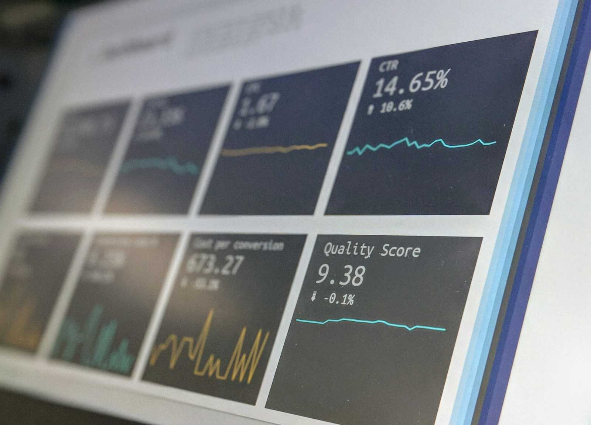
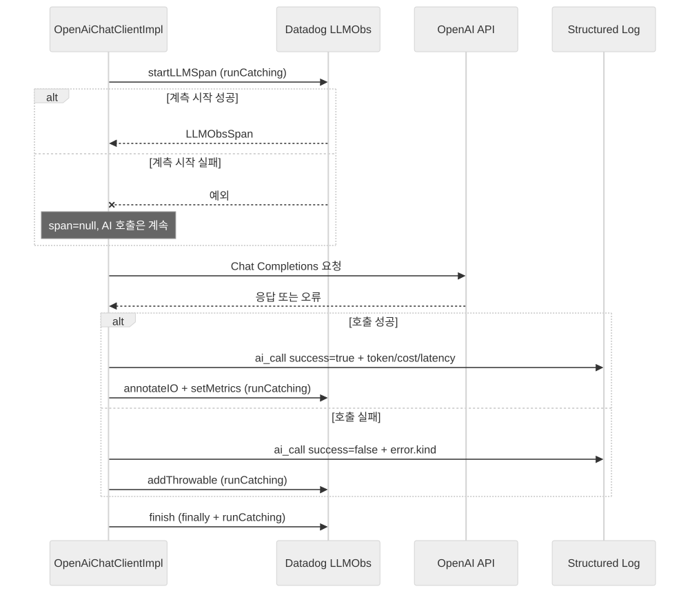

# Datadog 관측성 구축기 — LLM Observability부터 구조화 로그까지

안녕하세요. Jobdori 프로젝트에서 백엔드 개발을 맡은 정지원입니다.

서비스에 OpenAI 호출과 채용 공고 크롤링이 들어오면서 단순한 에러 수집만으로는 답하기 어려운 질문이 늘었습니다.

- 어떤 AI 기능이 느린가?
- 모델별 토큰 사용량과 비용은 어떻게 달라지는가?
- 실패가 OpenAI 장애인지 애플리케이션 계측 코드의 문제인지 어떻게 구분하는가?
- GraphQL 요청이 모두 `POST /api/graphql`로 보일 때 어떤 오퍼레이션이 느린지 어떻게 찾는가?
- 작은 개발 서버에서도 감당할 수 있는 관측성 구성은 어디까지인가?

이번 글에서는 이 질문에 답하기 위해 Datadog을 연동한 과정을 공유합니다. 처음에는 호스트 Agent, APM, JVM 지표, 로그, LLM Observability를 모두 수집하는 구성을 설계했습니다. 하지만 1GB 인스턴스의 배포 제약을 만나 Agentless 구조로 방향을 바꿨고, 그 과정에서 LLM 계측 코드가 실제 AI 호출을 모두 실패시키는 장애도 겪었습니다.

최종적으로는 다음 두 축에 집중했습니다.

1. **LLM Observability**: 자체 OpenAI 클라이언트를 수동 계측해 프롬프트, 응답, 토큰 사용량을 추적
2. **구조화 로그**: HTTP 요청, AI 호출, JD 크롤링, 오류를 Datadog이 바로 집계할 수 있는 JSON 필드로 기록



<small>측정할 수 있어야 개선할 수 있다. Photo by [Stephen Dawson on Unsplash](https://unsplash.com/photos/turned-on-monitoring-screen-qwtCeJ5cLYs).</small>

---

## 1. 배경: 외부 연동이 늘수록 로그의 역할도 달라졌다

### 1.1 서비스에서 관찰해야 했던 것

Jobdori 백엔드는 Kotlin과 Spring Boot 기반의 API 서버입니다. REST와 GraphQL 요청을 처리하고, 주요 기능에서 OpenAI API와 외부 채용 공고 페이지를 호출합니다.

| 대상 | 확인하고 싶은 값 | 실패 시 사용자 영향 |
|---|---|---|
| OpenAI 호출 | 기능, 모델, 지연시간, 재시도, 토큰, 비용 | AI 결과 생성 실패 또는 응답 지연 |
| JD 크롤링 | URL, 지연시간, 본문 길이, 성공 여부 | 채용 공고 자동 입력 실패 |
| API 요청 | 경로, 상태 코드, 처리시간, 사용자, GraphQL 오퍼레이션 | 느린 API와 오류 요청 추적 |
| 서버 오류 | 에러 종류, 코드, 스택 트레이스, 요청 문맥 | 500 원인 분석 |

기존에도 Sentry로 예외를 수집하고 있었고, 애플리케이션 로그에는 `ai_call`과 `jd_crawl` 같은 이벤트가 남았습니다. 문제는 로그가 “읽을 수 있는 문자열”에 가까웠다는 점입니다.

```text
ai_call useCase=resume_feedback model=gpt-4o-mini success=true
latencyMs=1842 retries=0 promptTokens=2120 completionTokens=430 costUsd=0.000576
```

사람이 한 건을 읽는 데는 충분하지만, 운영에서는 문자열을 넘어 다음 작업이 필요합니다.

- `latencyMs`의 p50, p95 계산
- `costUsd`의 기간별 합계
- `useCase`별 실패율 비교
- 오류 로그와 HTTP 요청 문맥 연결
- 특정 조건을 만족하는 로그 기반 알림

즉, 로그를 단순한 기록이 아니라 **집계 가능한 관측 데이터**로 바꿔야 했습니다.

### 1.2 처음 세운 목표

처음에는 Datadog의 기능을 넓게 활용하는 구성을 설계했습니다.

| 계층 | 수집 방식 | 기대한 데이터 |
|---|---|---|
| 호스트 | Datadog Agent | CPU, 메모리, 디스크 |
| JVM·웹 | `dd-java-agent`와 APM | JVM 런타임, HTTP, JPA, 외부 호출 트레이스 |
| 애플리케이션 | JSON 로그 | 요청, AI 호출, 크롤링, 예외 |
| LLM | LLM Observability 수동 계측 | 프롬프트, 응답, 토큰, 오류 |
| Actuator | Micrometer StatsD | Tomcat 스레드 같은 애플리케이션 지표 |

개발 환경은 AWS Elastic Beanstalk의 1GB 인스턴스에서 동작하고 있었습니다. 이 제약은 이후 전체 설계를 바꾸는 핵심 변수가 됐습니다.

---

## 2. 첫 번째 설계: 호스트 Agent를 중심으로 모두 연결하기

### 2.1 Agent 기반 아키텍처

처음 설계한 흐름은 모든 데이터를 같은 호스트의 Datadog Agent로 보내는 방식이었습니다.

```text
Elastic Beanstalk
├── Datadog Agent
│   ├── 호스트 지표 수집
│   ├── web.stdout.log / access log 테일링
│   ├── APM trace 수신
│   └── DogStatsD 지표 수신
└── Spring Boot + dd-java-agent
    ├── HTTP/JPA 자동 계측
    ├── JVM runtime metrics
    └── LLM Observability 수동 스팬
```

Agent 설치 스크립트를 Elastic Beanstalk의 `.platform/hooks/prebuild`에 넣고, 애플리케이션은 `-javaagent` 옵션으로 실행하도록 구성했습니다. Actuator 지표는 Micrometer StatsD를 통해 로컬 `8125` 포트로 보내는 계획이었습니다.

이 구조의 장점은 명확했습니다. 호스트, JVM, 요청, 데이터베이스, 외부 호출, 로그를 하나의 트레이스 문맥으로 연결할 수 있습니다.

### 2.2 Java Agent를 애플리케이션 의존성과 분리하기

`dd-java-agent.jar`는 애플리케이션 클래스패스에 넣는 일반 라이브러리가 아닙니다. JVM 시작 시 `-javaagent`로 로딩해야 하므로 별도 Gradle Configuration으로 관리하고 Elastic Beanstalk 배포 번들에 포함했습니다.

```kotlin
// jobdori-api/build.gradle.kts
val ddJavaAgent: Configuration by configurations.creating {
    isTransitive = false
}

dependencies {
    ddJavaAgent(libs.dd.java.agent)
}

tasks.register<Zip>("elasticBeanstalkBundle") {
    dependsOn(tasks.bootJar)

    from(tasks.bootJar.flatMap { it.archiveFile })
    from(ddJavaAgent) {
        rename { "dd-java-agent.jar" }
    }
    from(project.file("Procfile"))
}
```

반면 코드에서 `LLMObs` API를 호출하는 데 필요한 `dd-trace-api`는 OpenAI 구현체가 있는 infrastructure client 모듈에만 추가했습니다.

```kotlin
// jobdori-infrastructure/client/build.gradle.kts
dependencies {
    api(project(":jobdori-core"))
    implementation(libs.dd.trace.api)
}
```

이 분리는 프로젝트의 모듈 의존 방향도 지켰습니다. core는 Datadog을 전혀 모르고, 외부 OpenAI 구현체가 위치한 infrastructure만 계측 API에 의존합니다.

---

## 3. LLM Observability 수동 계측

### 3.1 자동 계측 대신 수동 계측을 선택한 이유

OpenAI 공식 SDK를 사용했다면 지원 범위 안에서 자동 계측을 기대할 수 있습니다. 이 프로젝트는 자체 `OpenAiHttpClient`와 `OpenAiChatClientImpl`을 사용하고 있었기 때문에, 실제 호출 지점에서 LLM 스팬을 직접 시작하고 종료해야 했습니다.

수동 스팬에 담은 정보는 다음과 같습니다.

| 분류 | 기록한 값 |
|---|---|
| 식별 | `useCase`, 모델, provider |
| 입력·출력 | system/user prompt, 모델 응답 |
| 사용량 | input, output, total token |
| 오류 | 호출 중 발생한 예외 |

기본 흐름은 단순합니다.

```kotlin
val llmSpan = LLMObs.startLLMSpan(
    useCase,
    body.model,
    "openai",
    null,
    null,
)

val response = http.post(
    "/chat/completions",
    body,
    OpenAiChatCompletionResponse::class.java,
)

llmSpan.annotateIO(
    body.messages.map { LLMObs.LLMMessage.from(it.role, it.content) },
    response.choices.map {
        LLMObs.LLMMessage.from(it.message.role, it.message.content)
    },
)
```

Datadog의 수동 계측 API는 토큰 수를 자동으로 알 수 없으므로 응답의 usage 값을 직접 전달했습니다.

```kotlin
response.usage?.let {
    llmSpan.setMetrics(
        mapOf(
            "input_tokens" to it.promptTokens,
            "output_tokens" to it.completionTokens,
            "total_tokens" to it.totalTokens,
        ),
    )
}
```

### 3.2 프롬프트 관측성과 개인정보의 충돌

LLM Observability의 장점은 실제 입력과 출력을 보면서 품질 문제를 분석할 수 있다는 점입니다. 하지만 이력서와 채용 공고를 다루는 서비스에서 프롬프트를 그대로 전송하면 개인정보가 함께 들어갈 수 있습니다.

명백한 식별자를 먼저 마스킹했습니다.

```kotlin
private val PII_PATTERNS = listOf(
    Regex("""\b\d{6}[-\s]?[1-4]\d{6}\b""") to "[rrn]",
    Regex("""[\w.+-]+@[\w-]+\.[\w.-]+""") to "[email]",
    Regex("""\b01[016-9][-.\s]?\d{3,4}[-.\s]?\d{4}\b""") to "[phone]",
)

private fun String.maskPii(): String =
    PII_PATTERNS.fold(this) { text, (pattern, replacement) ->
        text.replace(pattern, replacement)
    }
```

주민등록번호를 전화번호보다 먼저 치환한 것도 의도적인 순서입니다. 패턴이 겹칠 수 있는 입력에서 더 민감한 식별자를 먼저 처리해야 합니다.

<div class="notice--warning" markdown="1">
**⚠️ 정규식 마스킹의 한계**

이름, 회사명, 학교명처럼 문맥에 따라 개인정보가 되는 값은 단순한 정규식으로 완전히 제거할 수 없습니다. 마스킹만 믿지 않고 Datadog 접근 권한과 데이터 보존 범위를 함께 최소화해야 합니다.
</div>

---

## 4. 운영 환경의 전환: Agent 기반에서 Agentless로

### 4.1 1GB 인스턴스에서 마주친 현실

전체 Agent 구성을 개발 서버에 배포하는 과정에서 1GB 인스턴스의 리소스 제약으로 배포가 실패했습니다. 호스트 Agent, Java Agent, 애플리케이션을 모두 유지하면서 APM과 JVM 지표까지 수집하는 초기 설계를 그대로 가져가기 어려웠습니다.

여기서 선택지가 갈렸습니다.

| 선택 | 장점 | 단점 |
|---|---|---|
| 인스턴스 증설 | 초기 설계를 그대로 유지 | 개발 환경 비용 증가 |
| Datadog 기능 제거 | 배포가 가장 단순 | AI·로그 관측성까지 포기 |
| Agentless로 범위 축소 | 핵심 데이터 유지, 호스트 Agent 제거 | APM·JVM·호스트 지표 포기 |

개발 환경에서 가장 필요한 것은 AI 호출과 오류·요청 로그의 가시성이었습니다. 따라서 호스트 Agent를 제거하고 **로그 + LLM Observability**에 집중하는 구성을 선택했습니다.

### 4.2 최종 데이터 흐름

로그는 Elastic Beanstalk stdout에서 CloudWatch Logs로 전달되고, Datadog Forwarder Lambda가 이를 Datadog으로 보냅니다. LLM 스팬은 `dd-java-agent`의 Agentless LLM Observability 경로로 전송합니다.



최종 JVM 옵션은 다음과 같습니다. 실제 Procfile에서는 한 줄로 작성했습니다.

```bash
java \
  --enable-native-access=ALL-UNNAMED \
  -javaagent:dd-java-agent.jar \
  -Ddd.site=us5.datadoghq.com \
  -Ddd.env=dev \
  -Ddd.service=jobdori-api \
  -Ddd.version=$APP_VERSION \
  -Ddd.trace.enabled=true \
  -Ddd.runtime.metrics.enabled=false \
  -Ddd.logs.injection=true \
  -Ddd.llmobs.enabled=true \
  -Ddd.llmobs.agentless.enabled=true \
  -Ddd.llmobs.ml.app=scoop \
  -jar application.jar
```

Agentless 전환으로 포기한 것도 분명합니다.

- 호스트 CPU·메모리·디스크 지표
- APM의 HTTP·JPA 자동 트레이스
- JVM runtime metrics
- DogStatsD를 통한 Actuator 지표

관측성 도구를 연동했다고 모든 데이터가 자동으로 들어오는 것은 아닙니다. **현재 전송 경로가 실제로 존재하는 데이터만 대시보드에 사용해야 합니다.** 이 원칙 때문에 이후 대시보드와 모니터도 로그와 LLM Observability만 사용하도록 제한했습니다.

---

## 5. 계측 코드가 실제 기능을 깨뜨린 장애

### 5.1 AI 호출이 전부 500이 된 이유

Agentless 전환 직후 더 큰 문제가 발생했습니다. `DD_TRACE_ENABLED=false`이면서 LLM Observability만 활성화된 조합에서 `LLMObs.startLLMSpan`이 정상 스팬을 만들지 못했고, 계측 시작 과정의 예외가 OpenAI 호출보다 먼저 전파됐습니다.

결과적으로 OpenAI API 자체는 정상이어도 개발 환경의 AI 요청이 모두 500으로 실패했습니다.

초기 코드는 계측을 비즈니스 호출과 같은 실패 경계 안에 두고 있었습니다.

```kotlin
val llmSpan = LLMObs.startLLMSpan(...)
val response = http.post(...)
llmSpan.annotateIO(...)
llmSpan.finish()
```

이 구조에서는 다음 중 하나만 실패해도 사용자 기능이 실패합니다.

- 스팬 생성
- 입력·출력 annotation
- 토큰 metric 기록
- 스팬 종료

### 5.2 관측성은 실패해도 비즈니스는 살아 있어야 한다

계측의 모든 단계에 실패 격리를 적용했습니다.

```kotlin
val llmSpan = runCatching {
    LLMObs.startLLMSpan(useCase, body.model, "openai", null, null)
}.getOrNull()

try {
    return runCatching {
        callOpenAi()
    }
        .onSuccess { response ->
            OpenAiCallMetrics.logSuccess(...)
            runCatching {
                llmSpan?.let { annotateLlmSpan(it, body, response) }
            }
        }
        .onFailure { error ->
            OpenAiCallMetrics.logFailure(...)
            runCatching { llmSpan?.addThrowable(error) }
        }
        .getOrThrow()
} finally {
    runCatching { llmSpan?.finish() }
}
```

핵심은 `runCatching` 자체가 아니라 실패 경계를 어디에 두느냐입니다.

1. 스팬을 만들지 못하면 `null`로 두고 AI 호출을 계속한다.
2. annotation 실패는 AI 응답을 바꾸지 않는다.
3. 오류 기록 실패는 원래 OpenAI 예외를 덮어쓰지 않는다.
4. `finally`에서 종료하되 종료 실패도 밖으로 전파하지 않는다.



<div class="notice--success" markdown="1">
**✅ 관측성의 실패 원칙**

로그, 메트릭, 트레이스는 장애를 발견하기 위한 보조 시스템입니다. 보조 시스템의 실패가 관찰 대상인 핵심 기능을 중단시키면 의존 방향이 뒤집힙니다. 계측은 가능한 한 fail-open으로 설계해야 합니다.
</div>

### 5.3 같은 문제를 다시 놓치지 않기

코드만 고치는 것으로 끝내지 않고, 과거 오류 패턴을 감지하는 로그 모니터 정의를 추가했습니다.

```json
{
  "name": "[dev] LLM Obs 계측 파손 (AgentTracer buildSpan null)",
  "type": "log alert",
  "query": "logs(\"service:jobdori-api \\\"AgentTracer\\\" \\\"buildSpan\\\"\")... > 0"
}
```

15분 동안 같은 패턴이 한 건이라도 나타나면 계측 구성을 먼저 확인하도록 했습니다. 장애 수정 내용을 운영 신호로 남기지 않으면, 환경변수 변경이나 라이브러리 업데이트 이후 같은 문제가 반복돼도 다시 사용자 오류로 발견하게 됩니다.

---

## 6. 문자열 로그를 Datadog 구조화 로그로 바꾸기

### 6.1 Datadog 예약 속성에 맞춘 JSON 포맷

Spring Boot의 `StructuredLogFormatter`를 구현해 dev와 prod 프로필의 콘솔 로그를 JSON으로 전환했습니다.

```yaml
logging:
  structured:
    format:
      console: com.jobdori.api.support.logging.DatadogStructuredLogFormatter
```

포맷터는 MDC와 이벤트 payload를 먼저 복사하고, Datadog이 이해하는 표준 필드를 명시적으로 채웁니다.

```kotlin
override fun format(event: ILoggingEvent): String {
    val fields = linkedMapOf<String, Any?>()

    event.mdcPropertyMap.forEach { (key, value) ->
        fields[key] = value
    }
    event.keyValuePairs?.forEach { pair ->
        fields[pair.key] = pair.value
    }

    fields["timestamp"] = Instant
        .ofEpochMilli(event.timeStamp)
        .toString()
    fields["status"] = event.level.toString().lowercase()
    fields["service"] = serviceName
    fields["logger"] = event.loggerName
    fields["thread"] = event.threadName
    fields["message"] = event.formattedMessage

    event.throwableProxy?.let { proxy ->
        fields["error"] = mapOf(
            "kind" to proxy.className,
            "message" to proxy.message,
            "stack" to ThrowableProxyUtil.asString(proxy),
        )
    }

    return objectMapper.writeValueAsString(fields) + "\n"
}
```

여기서 필드명은 단순한 취향이 아닙니다. `service`와 `status`, `error.kind`, `error.stack` 같은 속성이 정확해야 Datadog Error Tracking과 기본 facet이 의도대로 동작합니다.

### 6.2 message와 payload를 둘 다 남긴 이유

`OpenAiCallMetrics`는 기존 전문 검색 쿼리를 깨뜨리지 않으면서 숫자 필드를 바로 집계할 수 있도록 두 표현을 함께 남깁니다.

```kotlin
val fields = linkedMapOf<String, Any?>(
    "useCase" to useCase,
    "model" to model,
    "success" to true,
    "latencyMs" to elapsedMs(startedNanos),
    "retries" to retries,
    "promptTokens" to response.usage?.promptTokens,
    "completionTokens" to response.usage?.completionTokens,
    "costUsd" to costUsd(model, response.usage),
    "finishReason" to response.choices.firstOrNull()?.finishReason,
)

log.atInfo {
    message = render(fields)
    payload = fields
}
```

| 표현 | 목적 |
|---|---|
| `message`의 `ai_call key=value...` | 기존 전문 검색과 사람이 읽는 로그 유지 |
| JSON 최상위 payload | facet, 숫자 집계, 대시보드 위젯 |

로그 스키마를 바꾸는 순간 대시보드와 모니터 쿼리도 함께 깨질 수 있습니다. 그래서 코드 주석에도 `ai_call`의 키 이름을 함부로 바꾸지 않도록 명시했습니다. 로그 필드는 내부 구현 세부가 아니라 운영 도구가 소비하는 하나의 API가 됐습니다.

### 6.3 `costUsd`가 문자열이면 합계를 낼 수 없다

구조화 로그로 바꾼 뒤에도 비용 합계가 계산되지 않는 문제가 남았습니다. 표시 자릿수를 맞추기 위해 `costUsd`를 미리 문자열로 포맷했기 때문입니다.

```kotlin
// 집계할 수 없는 형태
private fun costUsd(...): String =
    "%.6f".format(cost)
```

Datadog에는 숫자 원본을 보내고, 사람이 읽는 message를 만들 때만 반올림하도록 역할을 나눴습니다.

```kotlin
private fun costUsd(
    model: String,
    usage: OpenAiChatCompletionResponse.Usage?,
): Double? {
    val (inputPrice, outputPrice) =
        PRICE_PER_1M_TOKENS_USD[model] ?: return null
    if (usage == null) return null

    return (
        usage.promptTokens * inputPrice +
            usage.completionTokens * outputPrice
        ) / 1_000_000
}

private fun render(fields: Map<String, Any?>): String =
    fields.entries.joinToString(
        separator = " ",
        prefix = "ai_call ",
    ) { (key, value) ->
        "$key=${if (value is Double) "%.6f".format(value) else value}"
    }
```

이 작은 타입 변경으로 `costUsd`의 합계와 평균을 계산할 수 있게 됐습니다. 관측 데이터에서는 값의 내용뿐 아니라 **타입도 스키마의 일부**입니다.

---

## 7. 요청 문맥을 MDC로 연결하기

### 7.1 HTTP 요청마다 필요한 필드

로그 한 건만 보고도 어떤 요청에서 발생했는지 알 수 있도록 `OncePerRequestFilter`에서 Datadog 표준 속성을 MDC에 넣었습니다.

```kotlin
object MdcKeys {
    const val HTTP_METHOD = "http.method"
    const val HTTP_URL = "http.url"
    const val HTTP_STATUS_CODE = "http.status_code"
    const val CLIENT_IP = "network.client.ip"
    const val USER_ID = "usr.id"
    const val GRAPHQL_OPERATION = "graphql.operation"
}
```

요청이 시작될 때 method, URL, client IP를 기록하고, 인증이 완료되면 사용자 ID를 추가합니다. 요청이 끝날 때는 상태 코드와 전체 처리시간을 남깁니다.

```kotlin
MDC.put(MdcKeys.HTTP_METHOD, request.method)
MDC.put(MdcKeys.HTTP_URL, request.requestURI)
clientIp(request)?.let {
    MDC.put(MdcKeys.CLIENT_IP, it)
}

try {
    filterChain.doFilter(request, response)
} finally {
    MDC.put(
        MdcKeys.HTTP_STATUS_CODE,
        response.status.toString(),
    )
    logAccess(
        request,
        response,
        System.nanoTime() - startedNanos,
    )
    MdcKeys.ALL.forEach(MDC::remove)
}
```

처리시간은 Datadog 표준 `duration` 필드의 단위에 맞춰 나노초로 기록했습니다.

### 7.2 프록시와 스레드 재사용을 고려하기

Elastic Beanstalk의 로드밸런서 뒤에서는 `remoteAddr`이 실제 사용자가 아니라 프록시 주소일 수 있습니다. 따라서 `X-Forwarded-For`의 첫 값을 우선 사용했습니다.

```kotlin
private fun clientIp(request: HttpServletRequest): String? =
    request.getHeader("X-Forwarded-For")
        ?.substringBefore(',')
        ?.trim()
        ?.takeIf { it.isNotEmpty() }
        ?: request.remoteAddr
```

요청 종료 시 MDC 정리도 중요합니다. Tomcat 스레드는 재사용되므로 직접 넣은 값을 지우지 않으면 다음 요청 로그에 이전 사용자의 ID가 섞일 수 있습니다.

그렇다고 `MDC.clear()`를 호출하면 `dd-java-agent`가 주입한 trace/span ID까지 지울 수 있습니다. 애플리케이션이 넣은 키 목록만 선택적으로 제거한 이유입니다.

### 7.3 GraphQL은 URL만으로 구분할 수 없다

REST API는 URL로 기능을 구분할 수 있지만 GraphQL 요청은 모두 `POST /api/graphql`로 들어옵니다. URL만 남기면 어떤 query나 mutation이 느렸는지 알 수 없습니다.

`WebGraphQlInterceptor`에서 operation name을 MDC에 추가했습니다.

```kotlin
override fun intercept(
    request: WebGraphQlRequest,
    chain: WebGraphQlInterceptor.Chain,
): Mono<WebGraphQlResponse> {
    val operationName =
        request.operationName ?: return chain.next(request)

    MDC.put(MdcKeys.GRAPHQL_OPERATION, operationName)
    return chain.next(request)
}
```

인터셉터에서 바로 제거하지 않고 요청 필터가 액세스 로그를 남긴 뒤 일괄 제거합니다. 먼저 지우면 마지막 액세스 로그에서 operation name이 사라지기 때문입니다.

---

## 8. 대시보드와 모니터를 코드 가까이에 두기

### 8.1 실제로 들어오는 데이터만 사용하기

Agentless 전환 이후 Datadog 대시보드의 데이터 원천은 두 가지입니다.

1. CloudWatch Logs → Datadog Forwarder로 유입되는 애플리케이션 로그
2. Agentless로 전송되는 LLM Observability 스팬

호스트 Agent가 없으므로 `trace.*`, `jvm.*`, `system.*` 지표를 위젯에 넣으면 no-data만 표시됩니다. 대시보드 생성용 Bits AI 프롬프트에도 이 제약을 명시했습니다.

```text
There is no Datadog host Agent.
Do NOT use any APM (trace.*), JVM runtime,
or host/system metrics.

All widgets except the LLM Observability ones
must be log-based.
```

대시보드는 다음 영역으로 나눴습니다.

| 영역 | 주요 위젯 |
|---|---|
| Service health | 서버 오류 수, 오류 추이, LLM 계측 파손 |
| AI calls | 성공률, useCase·model별 호출, p50·p95 지연, 비용, 토큰 |
| JD crawling | 성공률, 성공·실패 추이, p50·p95 지연 |
| LLM Observability | 스팬 수, 오류율, 지연, 토큰 |
| Raw logs | `ai_call`, `jd_crawl` 원본 로그 |

### 8.2 로그 기반 모니터 정의

Datadog UI에서만 모니터를 만들면 설정의 의도와 변경 이력을 코드 리뷰에서 확인하기 어렵습니다. 재현 가능한 시작점이 되도록 JSON 정의를 저장했습니다.

| 모니터 | 조건 | 의도 |
|---|---|---|
| AI 호출 실패 | 10분간 5건 초과 | OpenAI 장애·한도·앱 오류 감지 |
| JD 크롤링 실패 | 15분간 10건 초과 | 사이트 마크업 변경·차단 감지 |
| API 서버 오류 | 10분간 5건 초과 | 처리되지 않은 예외 증가 감지 |
| LLM 계측 파손 | 15분간 0건 초과 | 과거 `buildSpan` 문제 재발 감지 |

이 JSON은 환경별 실제 트래픽을 반영한 완성된 임계값이라기보다 dev 환경의 초기 안전망입니다. 운영 데이터가 쌓이면 경고와 심각 임계값, 알림 채널, 재알림 간격을 조정해야 합니다.

<div class="notice--warning" markdown="1">
**⚠️ service 태그를 먼저 확인해야 한다**

Datadog Forwarder는 CloudWatch 로그 그룹 정보를 바탕으로 service를 추론할 수 있습니다. 코드에서 기대한 `service:jobdori-api`와 실제 유입 로그의 service가 다르면 모든 쿼리가 빈 결과를 냅니다. 모니터 JSON을 가져오기 전에 Logs Explorer의 실제 태그를 확인해야 합니다.
</div>

---

## 9. 모듈 구조 안에서 관측성 책임 나누기

Datadog 연동 코드도 기존 모듈 의존 방향을 깨지 않도록 배치했습니다.

```text
jobdori-api
└── support/logging
    ├── DatadogStructuredLogFormatter
    ├── RequestLoggingFilter
    └── GraphQLOperationMdcInterceptor

jobdori-infrastructure/client
└── ai/openai
    ├── OpenAiChatClientImpl
    └── OpenAiCallMetrics

jobdori-core
└── Datadog 의존 없음

docs/datadog
├── bits-dashboard-prompt.md
└── monitors/*.json
```

| 모듈 | 책임 |
|---|---|
| API | HTTP·GraphQL 요청 문맥과 콘솔 로그 포맷 |
| Infrastructure client | OpenAI 호출 계측과 외부 호출 지표 |
| Core | 기존 AI 유스케이스와 client 인터페이스 유지 |
| Docs | 대시보드·모니터를 재현하기 위한 운영 정의 |

이 구조에서는 Datadog을 제거하거나 다른 관측성 도구로 교체해도 core 유스케이스를 수정할 필요가 없습니다. 관측성은 여러 계층을 가로지르지만, 각 모듈에서는 자신이 소유한 경계의 정보만 추가합니다.

---

## 10. 결과

### 10.1 설계 변화

| 항목 | 초기 설계 | 최종 구성 |
|---|---|---|
| 수집 중심 | 호스트 Datadog Agent | 로그 + Agentless LLM Obs |
| 로그 경로 | Agent가 파일 테일링 | CloudWatch + Forwarder Lambda |
| APM | HTTP/JPA 자동 계측 계획 | dev 환경에서 사용하지 않음 |
| JVM·호스트 지표 | 수집 계획 | 리소스 제약으로 제외 |
| LLM 호출 | 수동 스팬 | 수동 스팬 + 계측 실패 격리 |
| 로그 포맷 | key=value 문자열 | Datadog 표준 속성 기반 JSON |
| 비용 필드 | 포맷된 문자열 | 집계 가능한 Double |
| 요청 구분 | URL 중심 | HTTP·사용자·GraphQL operation MDC |
| 운영 설정 | UI 작업 중심 | 대시보드 프롬프트와 모니터 JSON |

### 10.2 코드 수준에서 확보한 것

실제 트래픽의 전후 수치를 충분히 쌓지 않았기 때문에 “오류율이 몇 퍼센트 감소했다” 같은 결과를 만들지는 않았습니다. 대신 현재 코드에서 확인할 수 있는 변화는 명확합니다.

- Datadog 계측이 실패해도 OpenAI 호출 결과는 그대로 반환된다.
- AI 호출마다 성공 여부, 지연시간, 재시도, 토큰, 비용이 숫자 필드로 남는다.
- JD 크롤링도 같은 방식으로 성공 여부와 지연시간을 집계할 수 있다.
- 오류 로그가 `service`, `status`, `error.kind`, `error.stack`을 포함한다.
- 한 요청의 HTTP 정보, 사용자 ID, GraphQL operation을 로그에서 함께 찾을 수 있다.
- 과거에 겪은 LLM 계측 파손을 별도 모니터로 감지할 수 있다.
- 현재 데이터 경로에서 얻을 수 없는 APM·JVM 위젯을 대시보드에서 제외했다.

관측성 구축의 결과는 화려한 대시보드 자체가 아니라, 장애가 났을 때 **어디서 무엇을 확인해야 하는지가 코드와 문서에 남은 것**이라고 생각합니다.

---

## 11. 결론

### 11.1 배운 점

**1. 관측성은 핵심 기능보다 약한 의존성이어야 합니다.**

LLM 스팬 생성 실패가 OpenAI 호출 전체를 500으로 만든 경험이 가장 큰 교훈이었습니다. 계측 실패는 기록하되 사용자 기능을 중단시키지 않도록 실패 경계를 분리해야 합니다.

**2. 좋은 아키텍처는 운영 제약을 포함해야 합니다.**

Agent 기반 구성이 기능적으로 더 풍부하더라도 1GB 인스턴스에서 안정적으로 운영할 수 없다면 현재 환경의 답은 아닙니다. 로그와 LLM Obs에 집중한 Agentless 구조는 기능을 줄인 타협이지만, 실제로 유지 가능한 선택이었습니다.

**3. 로그 필드는 운영 API입니다.**

`ai_call`의 키 이름 하나를 바꾸면 검색 쿼리, facet, 대시보드, 모니터가 함께 깨집니다. 로그 스키마도 DTO나 외부 API처럼 타입과 호환성을 관리해야 합니다.

**4. 숫자는 끝까지 숫자로 보존해야 합니다.**

`costUsd`를 보기 좋게 포맷한 문자열로 보내자 합계를 낼 수 없었습니다. 저장과 전송에는 원본 숫자를 사용하고, 표현 계층에서만 반올림해야 합니다.

**5. 많이 수집하는 것보다 실제 경로를 정확히 아는 것이 중요합니다.**

호스트 Agent가 없는데 APM과 JVM 위젯을 추가하면 대시보드는 풍성해 보여도 데이터는 비어 있습니다. 어떤 데이터가 어떤 경로로 들어오는지부터 확인한 뒤 대시보드를 설계해야 합니다.

**6. LLM 관측성에는 개인정보 설계가 함께 들어가야 합니다.**

프롬프트와 응답은 디버깅 가치가 높지만 가장 민감한 데이터가 될 수도 있습니다. 마스킹, 권한, 보존 기간을 하나의 문제로 다뤄야 합니다.

### 11.2 마무리

이번 Datadog 연동은 “Agent를 설치하고 대시보드를 만든 작업”으로 끝나지 않았습니다. 실제 과정은 훨씬 더 많은 선택의 연속이었습니다.

- 무엇을 관찰할 것인가?
- 작은 인스턴스에서 어떤 데이터를 포기할 것인가?
- 자체 OpenAI 클라이언트를 어떻게 수동 계측할 것인가?
- 계측 실패를 비즈니스 실패와 어떻게 분리할 것인가?
- 문자열 로그를 어떤 타입과 필드명으로 내보낼 것인가?
- 운영 설정을 어떻게 다시 만들 수 있게 남길 것인가?

처음의 전체 Agent 설계와 최종 Agentless 구성은 다르지만, 이 전환 덕분에 관측성의 목적을 더 분명히 정리할 수 있었습니다. 모든 것을 수집하는 것보다 서비스의 핵심 위험을 설명할 수 있는 데이터를 안정적으로 남기는 것이 먼저였습니다.

이 글이 제한된 환경에서 Datadog이나 LLM Observability를 도입하는 분들에게 도움이 되었으면 합니다.

---

## 참고 자료

- [Datadog LLM Observability SDK Reference](https://docs.datadoghq.com/llm_observability/instrumentation/sdk/)
- [Datadog Backend Error Tracking](https://docs.datadoghq.com/logs/error_tracking/backend/)
- [Datadog Default Standard Attributes](https://docs.datadoghq.com/standard-attributes/)
- [Datadog Forwarder](https://docs.datadoghq.com/logs/guide/forwarder/)
- [Correlating Java Logs and Traces](https://docs.datadoghq.com/tracing/other_telemetry/connect_logs_and_traces/java/)
